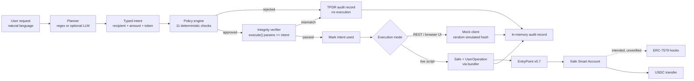
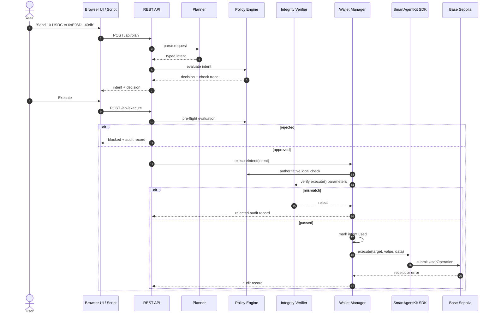

# Sentinel Wallet

### An AI-powered autonomous wallet with deterministic guardrails

**FinTechathon 2026 — Topic F: Autonomous On-chain Wallet**

Sentinel Wallet is a policy-governed smart-wallet prototype that lets an AI agent propose and execute token transfers without giving the agent unrestricted access to owner assets. The planner is treated as an untrusted intent producer; deterministic TypeScript checks and a pre-submission integrity verifier decide whether anything reaches the signing layer.

> **Submission status:** test-verified prototype with partial on-chain evidence. The off-chain policy and integrity pipeline is implemented and covered by 165 automated tests. The Safe Smart Account / ERC-4337 UserOperation and ERC-7579 on-chain enforcement paths are implemented in code but remain **pending verification**. This is not a production wallet and is not claimed to be fully secure.

---

## Why This Project Exists

Autonomous agents need to transact, but giving an LLM or an agent process an unrestricted private key creates an unacceptable failure mode. A prompt injection, hallucinated recipient, compromised server, or malicious plugin could drain the account.

Sentinel Wallet separates **intent** from **execution**:

- The AI can describe **what** it wants to do.
- It cannot construct arbitrary calldata, choose a protected target, or bypass policy.
- Deterministic code validates the request before signing.
- The long-term security boundary is intended to be the Safe Smart Account and its ERC-7579 hooks, not the model.

The result is a wallet architecture designed around a simple principle:

> **The agent proposes. Policy disposes. The chain enforces.**

The current prototype fully implements the first two layers and has deployed the on-chain contracts for the third. The on-chain enforcement layer is not yet proven active on the project Safe.

---

## At a Glance

| Area | Status | Evidence |
|------|--------|----------|
| Typed intent pipeline | **Verified** | 13 test files, 165/165 tests passing |
| Deterministic policy engine | **Verified** | 40 policy tests |
| Calldata integrity / TPDR | **Verified** | 12 integrity tests |
| Optional LLM planner | **Verified in unit tests** | 24 mocked-LLM tests; typed output only |
| TypeScript build | **Verified** | `npm run build` exits `0` |
| Offline end-to-end demo | **Verified** | 9 records: 2 approved, 7 rejected |
| Browser UI / REST API | **Mock only** | Uses `MockSentinelWalletManager`; random fake hashes |
| Contract bytecode on Base Sepolia | **Verified** | Read-only `eth_getCode` |
| Safe Smart Account deployed | **Verified** | Safe 1.4.1 at `0x6cDE...5123` |
| Owner EOA USDC transfer | **Verified** | Two successful Base Sepolia receipts |
| Safe UserOperation executed | **Not verified** | No `handleOps` transaction or `UserOperationEvent` |
| ERC-7579 hooks enforcing on the Safe | **Not verified** | Module not enabled; fallback handler unset |
| Production-ready / fully secure | **Not claimed** | See security self-assessment |

**Critical claim boundary:** the two confirmed transaction hashes are direct **owner EOA ERC-20 transfers**, not Safe UserOperations. They prove real testnet value movement from the owner account; they do not prove smart-account execution or hook enforcement.

---

## Core Capabilities

### 1. Untrusted natural-language planning

The planner accepts a request such as:

> “Send 10 USDC to 0xE06D8999DCfc16366A7A1C0189C22Bb9521940db.”

It produces a typed intent containing only:

- action
- recipient
- amount
- token

The optional LLM cannot supply raw calldata, an arbitrary target contract, or a function selector. Calldata is always derived locally by `buildTransferIntent()` using the ERC-20 `transfer(address,uint256)` ABI.

The deterministic regex planner remains available as a reproducible fallback and as the default offline demo path.

### 2. Deterministic policy engine

The policy engine runs eleven ordered checks and returns the first failure together with the complete check trace:

| Check | What it prevents |
|-------|------------------|
| Chain ID | Executing on the wrong network |
| Wallet binding | Signing for an unexpected account |
| Intent expiry | Executing stale requests |
| Intent replay | Reusing an already-consumed intent ID |
| Positive amount | Zero or malformed transfers |
| Function selector | Calling anything other than ERC-20 `transfer` |
| Calldata integrity | Target/calldata substitution |
| Recipient allowlist | Sending to an unapproved address |
| Spending limit | Exceeding the configured session/day limit |
| Per-transaction ceiling | Oversized single transfers |
| Pause state | Execution while the wallet is paused |

The policy engine is independent of the planner. A hallucinating or prompt-injected LLM is rejected by exactly the same checks as a regex-parsed request.

### 3. Pre-submission integrity verification

Before execution, `verifyIntegrity()` compares the parameters passed to the wallet SDK against the approved intent:

- chain ID
- wallet address
- target contract
- calldata
- decoded recipient
- decoded amount
- function selector

Any mismatch is converted into a hard `calldata_integrity` rejection. The intent is not marked used and no execution is attempted.

This check is a strong pre-dispatch control, but it is **not cryptographic**: it verifies the arguments passed to `client.execute()`, not the final signed UserOperation.

### 4. Fail-closed Safe execution

The live wallet manager supports the SmartAgentKit SDK path:

```text
UserOperation → bundler → EntryPoint v0.7 → Safe Smart Account → hooks → token
```

The current default is **strict Safe mode**. If the Safe or bundler path fails, execution fails closed. It does not silently fall back to the owner EOA.

A historical escape hatch exists for demos:

```text
SENTINEL_STRICT_SAFE=explicit-eoa-fallback
```

That path sends a direct owner EOA ERC-20 transfer. It is **not Safe execution** and must never be presented as such.

### 5. Audit trail

Every decision appends a TPDR record containing the intent, policy decision, optional integrity result, execution result, and timestamp. Approved and rejected requests are both recorded.

The current audit log is in-memory and is **not tamper-evident**. There is no signature, hash chain, or durable database.

---

## Architecture



### Trust boundaries

| Component | Trust level |
|-----------|-------------|
| User prompt | Untrusted |
| LLM output | Untrusted; schema-validated |
| Browser client | Untrusted; can send arbitrary JSON |
| Policy engine | Trusted deterministic code |
| Integrity verifier | Trusted pre-dispatch check with limited scope |
| Owner private key | Critical secret; single point of failure |
| Bundler | Untrusted for liveness; cannot forge owner signature |
| EntryPoint v0.7 | Trusted protocol contract |
| Safe Smart Account | Trusted account, but currently misconfigured for Safe7579 execution |
| ERC-7579 hooks | Intended trust anchor; installation/enforcement unverified |
| TPDR audit log | Not tamper-evident |

The key architectural point is that once the owner key signs, the Node.js policy boundary is no longer authoritative. Only the Safe/hook boundary can constrain a compromised signing process. That boundary is the critical remaining work.

---

## Request Lifecycle



**Important:** the REST API and browser UI currently use a mock wallet manager. The sequence above reaches the chain only through the live script path, and that path has not produced a confirmed Safe UserOperation.

---

## On-Chain Evidence

### Network

| Property | Value |
|----------|-------|
| Network | Base Sepolia |
| Chain ID | `84532` |
| Explorer | https://sepolia.basescan.org |
| Read-only check block | `48371037` |

### Confirmed owner EOA transactions

| Transaction | Block | What actually happened |
|-------------|------:|------------------------|
| [`0xdb8c...3592`](https://sepolia.basescan.org/tx/0xdb8c4aef52a7881bb5f220528636ce917953ac124feeef5f725fa8021c463592) | `48270886` | Owner EOA called USDC `transfer(0xE06D...40db, 1000000)`; status `1` |
| [`0xa140...f612`](https://sepolia.basescan.org/tx/0xa140c2b45a6733aea513e505ef00778f2b9e8bbd628beb8ff7ff7620136ff612) | `48353993` | Owner EOA called USDC `transfer(0xE06D...40db, 1000000)`; status `1` |

Both moved 1.00 USDC from the owner EOA to the approved recipient. Neither called the Safe, EntryPoint, or a hook. The second was produced by the historical “Direct Guardian Execution” fallback after a bundler simulation failure.

### Safe state (read-only)

| Query | Result |
|-------|--------|
| Safe address | `0x6cDE0BB1A5fb957d0e55c6E2dcd0a466c06D5123` |
| Safe version | `1.4.1` |
| Owner | `0x86ce071Fa058AF96b574aE2A4d646193f6a32321` |
| Threshold | `1` |
| Safe nonce | `1` |
| Safe7579 module enabled | `true` |
| HookMultiPlexer enabled | `false` |
| Safe7579 fallback-handler slot | `0x0` (unset) |
| EntryPoint nonce for Safe | `0` |
| EntryPoint deposit | `0` |
| USDC balance of Safe | `2.000000` |

A zero fallback handler and zero EntryPoint nonce mean the Safe execution surface is not currently usable as configured, and no UserOperation has been processed for this Safe.

### Deployed contracts

| Contract | Address |
|----------|---------|
| EntryPoint v0.7 | `0x0000000071727De22E5E9d8BAf0edAc6f37da032` |
| Safe7579 module | `0x7579EE8307284F293B1927136486880611F20002` |
| HookMultiPlexer | `0xF6782ed057F95f334D04F0Af1Af4D14fb84DE549` |
| SpendingLimitHook | `0xd67a5E6784A66Ddf4C09EA7bbf81Ab89532624E4` |
| AllowlistHook | `0x7899b03386A3874393A3769D637977d947A9Fc66` |
| EmergencyPauseHook | `0xAc0cE5672aED1Bfe5549b885f883a770Acd8cAE3` |
| USDC (Base Sepolia) | `0x036CbD53842c5426634e7929541eC2318f3dCF7e` |

Bytecode existence is verified. Source equivalence, runtime configuration, hook installation, and enforcement are not all verified.

The HookMultiPlexer has an ERC-7484 registry attestation and passes `checkForAccount`. The three individual hooks fail `checkForAccount` with `0xe424f994`; individual hook attestation is not claimed.

---

## Test Evidence

Executed on 20 October 2026 with Node.js `24.22.0` and npm `11.19.1`.

```text
Test Files  13 passed (13)
     Tests  165 passed (165)
  Duration  13.29s
```

| Test file | Tests | Focus |
|-----------|------:|-------|
| `auth.test.ts` | 9 | Registration, login, sessions, lockout |
| `csrfAndIpTrust.test.ts` | 9 | CSRF/origin checks, proxy/IP trust |
| `httpMultiUser.test.ts` | 1 | Local HTTP multi-user flow |
| `integrity.test.ts` | 12 | Calldata/target/recipient/amount tampering |
| `intent.test.ts` | 13 | Intent construction, calldata, IDs |
| `llm-planner.test.ts` | 24 | Schema validation, mocked LLM, fallback |
| `multiUserIsolation.test.ts` | 3 | Per-user policy isolation |
| `planner.test.ts` | 9 | Regex parsing and validation |
| `policy.test.ts` | 40 | All eleven policy checks |
| `safe-strict-mode.test.ts` | 4 | Fail-closed behavior with stub client |
| `security.test.ts` | 22 | End-to-end security scenarios with mock SDK |
| `settings.test.ts` | 16 | API-key masking and settings updates |
| `wallet-reconnect.test.ts` | 3 | Wallet reconnect flow |
| **Total** | **165** | **165 passed, 0 failed** |

Additional verification:

```text
npm run build   → exit 0
npm run demo:mock → Total records: 9 | Approved: 2 | Rejected: 7
```

These tests do **not** prove live bundler submission, Safe UserOperation execution, or on-chain hook enforcement.

---

## Quick Start

### Requirements

- Node.js `>= 22` (verified with Node `24.22.0`)
- npm `11.x`
- No keys or network needed for the mock demo and automated tests

```bash
cd sentinel-wallet
npm install
npm test
npm run build
npm run demo:mock
```

### Run the browser demo / REST API

```bash
cd sentinel-wallet
npm run dev
# Open http://localhost:3000
```

The UI is a **simulation**. It does not broadcast transactions and returns random mock hashes. Do not use those hashes as on-chain evidence.

### Optional LLM planner

```bash
cd sentinel-wallet
npm run demo:llm
```

Requires an LLM endpoint in `.env` or supplied per session in the UI. Supported formats include OpenAI-compatible endpoints and Anthropic.

### Live Base Sepolia path — advanced, can spend funds

> **Warning:** this path can broadcast transactions. Use only a dedicated testnet key with minimal funds. The Safe/UserOperation path is currently unverified and may fail closed.

```bash
cd sentinel-wallet
cp .env.example .env
# Configure RPC_URL, BUNDLER_URL, OWNER_PRIVATE_KEY, APPROVED_RECIPIENT, token addresses
npm run live:test
```

The default is strict Safe mode. The owner-EOA fallback exists only as an explicit opt-in escape hatch and is not Safe execution.

---

## Security Controls

| Control | Layer | Current status |
|---------|-------|----------------|
| Typed intent only; no raw calldata from planner | Off-chain | Implemented and tested |
| Chain ID binding | Off-chain | Implemented and tested |
| Wallet binding | Off-chain | Implemented and tested |
| Intent expiry (5-minute default) | Off-chain | Implemented and tested |
| Replay prevention | Off-chain | In-memory set; resets on restart |
| Recipient allowlist | Off-chain | Implemented and tested |
| Spending limit | Off-chain | Implemented and tested |
| Per-transaction ceiling | Off-chain | Implemented and tested |
| Selector and calldata integrity | Off-chain | Implemented and tested |
| Emergency pause | Off-chain | Implemented; does not call the on-chain hook |
| Owner authorization | On-chain signature | Single owner EOA |
| ERC-4337 replay protection | On-chain | EntryPoint nonce; no confirmed UserOperation |
| On-chain spending limit / allowlist / pause | On-chain | Deployed but not proven installed or enforcing |

### Known limitations

1. **Safe UserOperation path is unverified.** No `handleOps` transaction, UserOperation hash, or `UserOperationEvent`.
2. **On-chain hooks are unverified.** Safe7579 fallback handler is `0x0`; HookMultiPlexer is not enabled on the project Safe.
3. **The browser demo is mock-only.** Random hashes are not chain transactions.
4. **Off-chain state is in-memory.** Replay sets, spend counters, sessions, users, settings, and audit records reset on restart.
5. **Execution isolation is incomplete.** The REST server uses a shared mock manager; per-user settings are isolated, but execution state is not.
6. **The audit trail is not tamper-evident.** TPDR records are unsigned in-memory objects.
7. **The owner key signs everything.** A compromised server or owner key bypasses the off-chain policy engine.
8. **Integrity verification has limited scope.** It checks `client.execute()` arguments, not the final signed UserOperation.
9. **No fork or live-chain automated tests.** The 165 tests are unit and local HTTP integration tests.
10. **Secret hygiene requires action.** `.env.example` contains a credential-like value that must be replaced and rotated.
11. **Not production-ready.** No independent audit, durable storage, monitoring, key-management service, or verified on-chain enforcement.

See the full [Security Self-Assessment](sentinel-wallet/docs/competition/SECURITY_SELF_ASSESSMENT.md) for the threat model and 25-item risk register.

---

## Topic F Requirement Coverage

| Requirement | Status | Notes |
|-------------|--------|-------|
| Autonomous agent interprets intent | **Complete** | Deterministic and optional LLM planners |
| Agent cannot hold unrestricted key | **Design-complete, partial in practice** | Web flow mock-only; live script uses owner key |
| Policy engine constrains execution | **Complete off-chain** | Eleven checks, 165 tests |
| Safe Smart Account integration | **Partial** | Deployed and connectable; no confirmed UserOperation |
| ERC-4337 UserOperation flow | **Partial** | SDK path implemented; no confirmed execution |
| On-chain policy enforcement | **Blocked / unverified** | Contracts deployed; installation and enforcement unproven |
| Spending limits and allowlist | **Off-chain complete; on-chain unverified** | Hooks deployed, not proven active |
| Emergency pause | **Off-chain complete; on-chain unverified** | API pause does not call the hook |
| Audit trail | **Complete in-memory** | Not durable or tamper-evident |
| Real on-chain evidence | **Partial** | Two owner EOA transfers; no Safe UserOperation |
| Security self-assessment | **Complete** | Full risk register and explicit unknowns |
| Presentation deck / video | **Not present** | Remaining submission task |

---

## Repository Layout

| Path | Contents |
|------|----------|
| `sentinel-wallet/` | Main application, tests, scripts, and documentation |
| `sentinel-wallet/src/` | Intent, policy, integrity, planners, wallet, auth, server |
| `sentinel-wallet/scripts/` | Live test, on-chain verification, Safe inspection and recovery |
| `sentinel-wallet/docs/competition/` | Five competition documents |
| `sentinel-wallet-ui/` | Browser UI assets |
| `mini-freellm/` | Supporting LLM router project |
| `stitch_sentinel_wallet_enterprise_dashboard/` | Design artifacts |

### Documentation

| Document | Purpose |
|----------|---------|
| [Project README](sentinel-wallet/README.md) | Detailed setup, commands, and evidence |
| [Technical Documentation](sentinel-wallet/docs/competition/TECHNICAL_DOCUMENTATION.md) | Architecture, pipeline, integration, limitations |
| [Security Self-Assessment](sentinel-wallet/docs/competition/SECURITY_SELF_ASSESSMENT.md) | Threat model, trust boundaries, risk register |
| [Testing and Execution Evidence](sentinel-wallet/docs/competition/TESTING_AND_EXECUTION_EVIDENCE.md) | Commands, test counts, receipts, missing proof |
| [Architecture and Data Flow](sentinel-wallet/docs/competition/ARCHITECTURE_AND_DATA_FLOW.md) | Module responsibilities, sequence diagrams |
| [Competition Submission Checklist](sentinel-wallet/docs/competition/COMPETITION_SUBMISSION_CHECKLIST.md) | Requirement-by-requirement status |

---

## Roadmap to Verified Safe Execution

1. Repair the Safe7579 fallback handler with a confirmed `setFallbackHandler` transaction.
2. Install and verify the HookMultiPlexer and the three policy hooks on the Safe.
3. Submit a funded Base Sepolia UserOperation through a bundler.
4. Capture the UserOperation hash, `handleOps` transaction hash, and `UserOperationEvent`.
5. Show the EntryPoint nonce increment.
6. Demonstrate an over-limit or unapproved-recipient UserOperation reverting on-chain.
7. Replace the single owner-key model with a scoped session key or Safe module permission.
8. Add durable, tamper-evident audit storage.
9. Add Anvil fork tests and a live-chain verification suite.
10. Produce the competition deck and a short demo video.

Until steps 1–6 are complete, Sentinel Wallet is an **off-chain-verified prototype with partial on-chain evidence**, not a fully verified autonomous smart-account system.

---

## Final Claim Boundary

The strongest defensible claim for judges is:

> Sentinel Wallet is a test-verified autonomous wallet prototype with a deterministic off-chain policy and integrity pipeline. It has two confirmed Base Sepolia **owner EOA** USDC transfers. Its Safe Smart Account / ERC-4337 UserOperation execution path and ERC-7579 on-chain hook enforcement are implemented in code but remain **pending verification**.

Do not claim a confirmed Safe execution, on-chain hook enforcement, or production readiness until a UserOperation hash, `handleOps` transaction, and `UserOperationEvent` are available and verified.
