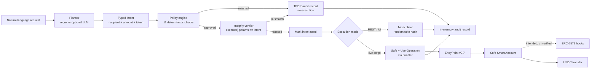

# Sentinel Wallet

> **FinTechathon 2026 — Topic F: Autonomous On-chain Wallet**
>
> A policy-governed smart-wallet prototype that lets an AI agent propose and execute token transfers without giving the agent unrestricted control of owner assets.

---

## Verification Status (Read This First)

Sentinel Wallet is **a test-verified prototype with partial on-chain evidence**, not a production wallet and not a fully verified smart-account implementation.

| Claim | Status | Evidence |
|-------|--------|----------|
| Typed intent pipeline, policy engine, integrity checks | **Verified** | `npm test` — 13 files, 165/165 tests passing (20 Oct 2026) |
| TypeScript build / type-check | **Verified** | `npm run build` exits `0` |
| Offline mock demo | **Verified** | `npm run demo:mock` — 9 records, 2 approved, 7 rejected |
| Browser UI and REST API | **Mock only** | Server imports `MockSentinelWalletManager`; mock hashes are random |
| Contract bytecode deployed on Base Sepolia | **Verified** | Read-only `eth_getCode` at documented addresses |
| Safe Smart Account deployed | **Verified** | Safe 1.4.1 proxy at `0x6cDE...5123`; owner and threshold read on-chain |
| Owner EOA ERC-20 transfer confirmed | **Verified** | `0xdb8c...3592` and `0xa140...f612`, both successful Base Sepolia receipts |
| Safe Smart Account UserOperation confirmed | **Not verified** | No `handleOps` transaction or `UserOperationEvent` captured; EntryPoint nonce is `0` |
| ERC-7579 hooks installed and enforcing on this Safe | **Not verified** | HookMultiPlexer module not enabled; Safe7579 fallback-handler slot is `0x0` |
| On-chain policy rejection demonstrated | **Not verified** | No real hook revert evidence |
| Production-ready / fully secure | **No** | See the security self-assessment |

The two confirmed transaction hashes are **direct USDC transfers signed by the owner EOA**, not Safe UserOperations. They must not be presented as proof of smart-account or hook execution.

**Full evidence and caveats:**
- [Technical Documentation](docs/competition/TECHNICAL_DOCUMENTATION.md)
- [Security Self-Assessment](docs/competition/SECURITY_SELF_ASSESSMENT.md)
- [Testing and Execution Evidence](docs/competition/TESTING_AND_EXECUTION_EVIDENCE.md)
- [Architecture and Data Flow](docs/competition/ARCHITECTURE_AND_DATA_FLOW.md)
- [Competition Submission Checklist](docs/competition/COMPETITION_SUBMISSION_CHECKLIST.md)

---

## Overview

An autonomous wallet has a fundamental conflict: the agent needs enough authority to act, but not enough to drain the account. Sentinel Wallet separates the request from execution with three layers:

1. **Untrusted intent generation** — a natural-language request is converted into a typed `TransactionIntent`. The planner may be a deterministic regex parser or an optional LLM, but it can only supply `(recipient, amount, token)`. It never supplies calldata, a target contract, or a selector.
2. **Deterministic off-chain enforcement** — an 11-check policy engine validates chain, wallet binding, expiry, replay, recipient allowlist, spending limit, per-transaction ceiling, selector, pause state, and intent integrity before signing.
3. **Pre-submission integrity check** — the execution parameters passed to the wallet SDK are compared with the approved intent. Any mismatch becomes a hard rejection.

The intended fourth layer is **on-chain enforcement** through a Safe Smart Account, ERC-4337 EntryPoint, and ERC-7579 hooks (spending limit, allowlist, emergency pause). Those contracts are deployed, but hook installation and UserOperation execution on the project Safe remain **unverified**.

---

## What Is Implemented

| Capability | Implementation |
|------------|----------------|
| Typed transfer intents | `src/intent.ts` — validates fields, ABI-encodes `transfer(address,uint256)`, generates a random intent ID and expiry |
| Deterministic policy engine | `src/policy.ts` — 11 ordered checks, first failure returned with a full check trace |
| Calldata integrity / TPDR | `src/integrity.ts` — compares chain, wallet, target, calldata, recipient, amount, selector |
| Regex planner | `src/planner.ts` — reproducible natural-language parser and demo scenarios |
| Optional LLM planner | `src/llm-planner.ts` — OpenAI-compatible and Anthropic formats, typed-output validation, regex fallback |
| Wallet orchestration | `src/wallet.ts` — policy → integrity → replay marking → execute → audit record |
| Mock SDK client | `@smartagentkit/testing` — in-memory allowlist/limit/pause simulation and random fake hashes |
| Live Safe path | `@smartagentkit/sdk` — builds and submits a UserOperation via a bundler; strict fail-closed by default |
| REST API and UI | `src/server.ts` + `sentinel-wallet-ui/index.html` — auth, plan, execute, audit, settings, pause |
| Authentication | `src/auth.ts` — PBKDF2-SHA512, sessions, login lockout, registration rate limiting |
| Secret-safe settings | `src/settings.ts` — API-key masking and masked-value rejection |
| Audit records (TPDR) | In-memory audit entries per decision, including rejected attempts |

### Planner safety properties

- The LLM output schema allows only `{action, recipient, amount, token}`.
- Addresses are validated as 20-byte hex; amounts must be plain positive decimals.
- Calldata is always derived locally by `buildTransferIntent()`.
- Planner provenance is recorded (`llm-planner:<model>` or the deterministic planner).
- A planner failure produces no intent; the policy engine is independent of the planner.

See [TECHNICAL_DOCUMENTATION.md](docs/competition/TECHNICAL_DOCUMENTATION.md) for the full pipeline and [ARCHITECTURE_AND_DATA_FLOW.md](docs/competition/ARCHITECTURE_AND_DATA_FLOW.md) for module-level details.

---

## Architecture



### Runtime paths

| Path | Entry point | Reaches chain? | Current status |
|------|-------------|----------------|----------------|
| Offline demo | `npm run demo:mock` | No | Verified |
| REST API / browser UI | `npm run dev` | No — mock manager only | Verified as mock |
| Live transfer script | `npm run live:test` | Yes, when funded and configured | Historically fell back to owner EOA; strict Safe mode now fails closed |
| Safe inspection | `npx tsx scripts/inspect-safe.ts` | Read-only | Available |
| Safe fallback repair | `npx tsx scripts/recover-safe-7579.ts` | Dry-run by default | Broadcast not performed for this documentation |

---

## Quick Start

### Requirements

- Node.js `>= 22` (verified with Node `24.22.0`)
- npm `11.x`
- No keys or network needed for the mock demo and tests

### Install and verify

```bash
cd sentinel-wallet
npm install
npm test
npm run build
npm run demo:mock
```

Expected results at the documented snapshot:

```text
Test Files  13 passed (13)
     Tests  165 passed (165)
```

```text
Total records: 9
Approved: 2  Rejected: 7
```

### Run the API and UI

```bash
npm run dev
# Open http://localhost:3000
```

The REST/UI path is a **simulation**. It does not create a Safe UserOperation, does not broadcast a transaction, and returns random mock transaction hashes. Do not use those hashes as on-chain evidence.

### Optional LLM planner

```bash
npm run demo:llm
```

Requires an LLM endpoint configured in `.env` (or supplied per session in the UI). Supported formats include OpenAI-compatible endpoints and Anthropic.

### Live Base Sepolia path (advanced, can spend funds)

> **Warning:** this path can broadcast transactions. Never use a key that controls real assets. The Safe/UserOperation path is currently unverified and may fail closed.

```bash
cp .env.example .env
# Fill in RPC_URL, BUNDLER_URL, OWNER_PRIVATE_KEY, APPROVED_RECIPIENT, token addresses
npm run live:test
```

Use only a dedicated testnet key with minimal funds. The default execution mode is strict Safe mode; the owner-EOA fallback exists only as an explicit opt-in escape hatch (`SENTINEL_STRICT_SAFE=explicit-eoa-fallback`) and is not Safe execution.

---

## On-Chain Evidence

### Network

| Property | Value |
|----------|-------|
| Network | Base Sepolia |
| Chain ID | `84532` |
| Explorer | https://sepolia.basescan.org |
| Read-only check block | `48371037` |

### Confirmed transactions — owner EOA, not Safe UserOperations

| Hash | Block | What it is |
|------|------:|------------|
| [`0xdb8c...3592`](https://sepolia.basescan.org/tx/0xdb8c4aef52a7881bb5f220528636ce917953ac124feeef5f725fa8021c463592) | `48270886` | Owner EOA calls USDC `transfer(0xE06D...40db, 1000000)`; status `1` |
| [`0xa140...f612`](https://sepolia.basescan.org/tx/0xa140c2b45a6733aea513e505ef00778f2b9e8bbd628beb8ff7ff7620136ff612) | `48353993` | Owner EOA calls USDC `transfer(0xE06D...40db, 1000000)`; status `1` |

Both transactions moved 1.00 USDC from the owner EOA to the approved recipient. Neither transaction called the Safe, EntryPoint, or a hook. The second was produced by the historical “Direct Guardian Execution” fallback after a bundler simulation failure.

### Safe state (read-only)

| Query | Result |
|-------|--------|
| Safe address | `0x6cDE0BB1A5fb957d0e55c6E2dcd0a466c06D5123` |
| Safe version | `1.4.1` |
| Owner | `0x86ce071Fa058AF96b574aE2A4d646193f6a32321` |
| Threshold | `1` |
| Safe nonce | `1` |
| Safe7579 module enabled | `true` |
| HookMultiPlexer module enabled | `false` |
| Safe7579 fallback-handler slot | `0x0` (unset) |
| EntryPoint nonce for Safe | `0` |
| EntryPoint deposit | `0` |
| USDC balance of Safe | `2.000000` |

A zero fallback handler and zero EntryPoint nonce mean the Safe execution surface is **not currently usable as configured**, and no UserOperation has been processed for this Safe.

### Deployed contracts

| Contract | Address |
|----------|---------|
| EntryPoint v0.7 | `0x0000000071727De22E5E9d8BAf0edAc6f37da032` |
| Safe7579 module | `0x7579EE8307284F293B1927136486880611F20002` |
| HookMultiPlexer | `0xF6782ed057F95f334D04F0Af1Af4D14fb84DE549` |
| SpendingLimitHook | `0xd67a5E6784A66Ddf4C09EA7bbf81Ab89532624E4` |
| AllowlistHook | `0x7899b03386A3874393A3769D637977d947A9Fc66` |
| EmergencyPauseHook | `0xAc0cE5672aED1Bfe5549b885f883a770Acd8cAE3` |
| USDC (Base Sepolia) | `0x036CbD53842c5426634e7929541eC2318f3dCF7e` |

Bytecode existence is verified. Runtime configuration, source equivalence, hook installation, and enforcement are not all verified.

The HookMultiPlexer has an ERC-7484 registry attestation and passes `checkForAccount`. The three individual hooks fail `checkForAccount` with `0xe424f994`; do not claim individual hook attestation.

---

## Security Model and Limits

| Control | Layer | Status |
|---------|-------|--------|
| Chain ID binding | Off-chain | Implemented and tested |
| Wallet binding | Off-chain | Implemented and tested |
| Intent expiry | Off-chain | Implemented and tested; default 5 minutes |
| Intent replay prevention | Off-chain | In-memory set; resets on restart |
| Recipient allowlist | Off-chain | Implemented and tested |
| Daily spending limit | Off-chain | Implemented and tested |
| Per-transaction ceiling | Off-chain | Implemented and tested |
| Selector restriction / calldata integrity | Off-chain | Implemented and tested |
| Emergency pause | Off-chain | Implemented; API pause does not call the on-chain hook |
| Owner authorization | On-chain signature | Single owner EOA signs; no scoped session key |
| ERC-4337 replay protection | On-chain | EntryPoint nonce implemented by protocol; no confirmed UserOperation |
| On-chain spending limit / allowlist / pause | On-chain | Deployed contracts; not proven installed or enforcing on this Safe |

### Known limitations

1. **Safe UserOperation path is unverified.** There is no confirmed `handleOps` transaction, UserOperation hash, or `UserOperationEvent`.
2. **On-chain hook enforcement is unverified.** The Safe7579 fallback handler is unset, the multiplexer is not enabled, and no hook-install transaction is documented.
3. **The REST/UI demo is mock-only.** Mock transaction hashes are random and cannot be verified on BaseScan.
4. **Off-chain state is in-memory.** Intent replay sets, spend counters, sessions, users, settings, and audit records reset on restart.
5. **Execution isolation is incomplete.** The REST server uses a shared mock manager; per-user settings are isolated, but execution state is not.
6. **The audit log is not tamper-evident.** TPDR records are plain in-memory objects with no signatures or hash chain.
7. **The owner key signs everything.** A compromised server process or owner key bypasses the off-chain policy engine.
8. **The integrity check has a limited scope.** It verifies arguments passed to `client.execute()`, not the final signed UserOperation.
9. **No fork/live-chain automated tests.** The 165 tests are unit and local HTTP integration tests; there are no Anvil fork tests or live-chain assertions.
10. **Secret hygiene requires action.** `.env.example` contains a credential-like value and must be replaced with an empty placeholder before publication; rotate any exposed key.
11. **Not production-ready.** No independent audit, durable storage, monitoring, key-management service, or verified on-chain enforcement.

A more complete risk register is in [SECURITY_SELF_ASSESSMENT.md](docs/competition/SECURITY_SELF_ASSESSMENT.md).

---

## Test Catalogue

Executed on 20 October 2026 from the working tree described in the evidence document.

| Test file | Tests | Classification |
|-----------|------:|----------------|
| `auth.test.ts` | 9 | Unit |
| `csrfAndIpTrust.test.ts` | 9 | Unit + local HTTP |
| `httpMultiUser.test.ts` | 1 | Local HTTP integration |
| `integrity.test.ts` | 12 | Unit |
| `intent.test.ts` | 13 | Unit |
| `llm-planner.test.ts` | 24 | Unit, mocked fetch |
| `multiUserIsolation.test.ts` | 3 | Unit |
| `planner.test.ts` | 9 | Unit |
| `policy.test.ts` | 40 | Unit |
| `safe-strict-mode.test.ts` | 4 | Unit, stub client |
| `security.test.ts` | 22 | Unit + mock SDK |
| `settings.test.ts` | 16 | Unit |
| `wallet-reconnect.test.ts` | 3 | Unit + mock manager |
| **Total** | **165** | **165 passed, 0 failed** |

These tests do **not** prove on-chain hook enforcement. See [TESTING_AND_EXECUTION_EVIDENCE.md](docs/competition/TESTING_AND_EXECUTION_EVIDENCE.md) for commands, per-file results, transaction receipts, and missing evidence.

---

## Repository Layout

```text
sentinel-wallet/
├── src/
│   ├── types.ts          # Shared pipeline types
│   ├── intent.ts         # Typed intent builder and calldata encoding
│   ├── policy.ts         # Deterministic policy engine
│   ├── integrity.ts      # Pre-submission calldata verification
│   ├── planner.ts        # Deterministic planner and demo scenarios
│   ├── llm-planner.ts    # Optional LLM planner with validation and fallback
│   ├── wallet.ts         # Live and mock wallet managers
│   ├── auth.ts           # Users, sessions, rate limits
│   ├── settings.ts       # API-key masking and safe updates
│   ├── server.ts         # REST API and UI server
│   ├── demo.ts           # Offline and live demo runners
│   └── __tests__/        # 13 Vitest files
├── scripts/
│   ├── live-test.ts      # Live transfer attempt
│   ├── verify-onchain.ts # Read-only bytecode verification
│   ├── inspect-safe.ts   # Read-only Safe/EntryPoint/registry inspection
│   └── recover-safe-7579.ts # Safe fallback-handler repair (dry-run default)
├── docs/
│   ├── competition/      # Five competition documents
│   ├── security-model.md
│   └── llm-audit.md
├── .env.example
├── package.json
└── tsconfig.json
```

---

## Useful Commands

| Command | Purpose | Reaches chain? |
|---------|---------|----------------|
| `npm test` | Run all 165 tests | No |
| `npm run build` | Type-check with `tsc --noEmit` | No |
| `npm run demo:mock` | Offline end-to-end demo | No |
| `npm run demo:llm` | Mock demo through the LLM planner | LLM endpoint only |
| `npm run dev` | REST API and UI on port 3000 | No (mock manager) |
| `npm run verify:onchain` | Read-only bytecode/environment check | Read-only RPC |
| `npx tsx scripts/inspect-safe.ts` | Read-only Safe/EntryPoint inspection | Read-only RPC; includes gas estimation |
| `npm run live:test` | Live transfer attempt | **Yes, can broadcast** |
| `npx tsx scripts/recover-safe-7579.ts` | Safe fallback-handler repair, dry-run | Read-only unless `--broadcast` |
| `npx tsx scripts/recover-safe-7579.ts --broadcast` | Broadcast repair | **Yes, can broadcast** |

No broadcast was performed for the documentation package.

---

## Documentation

| Document | Purpose |
|----------|---------|
| [Technical Documentation](docs/competition/TECHNICAL_DOCUMENTATION.md) | System design, pipeline, integration, limitations |
| [Security Self-Assessment](docs/competition/SECURITY_SELF_ASSESSMENT.md) | Threat model, trust boundaries, risk register, unverified items |
| [Testing and Execution Evidence](docs/competition/TESTING_AND_EXECUTION_EVIDENCE.md) | Exact commands, test counts, transaction receipts, missing proof |
| [Architecture and Data Flow](docs/competition/ARCHITECTURE_AND_DATA_FLOW.md) | Modules, sequence diagrams, local vs on-chain enforcement |
| [Competition Submission Checklist](docs/competition/COMPETITION_SUBMISSION_CHECKLIST.md) | Requirement-by-requirement status and pre-submission actions |
| [Security Model](docs/security-model.md) | Earlier threat-model notes |
| [LLM Audit](docs/llm-audit.md) | LLM provider notes |

---

## Competition Submission Note

The strongest defensible claim is:

> Sentinel Wallet is a test-verified autonomous wallet prototype with a deterministic off-chain policy and integrity pipeline. It has two confirmed Base Sepolia **owner EOA** USDC transfers. Its Safe Smart Account / ERC-4337 UserOperation execution path and ERC-7579 on-chain hook enforcement are implemented in code but remain **pending verification**.

Do not claim a confirmed Safe execution, hook enforcement, or production readiness until a UserOperation hash, `handleOps` transaction, and `UserOperationEvent` are available and verified.
