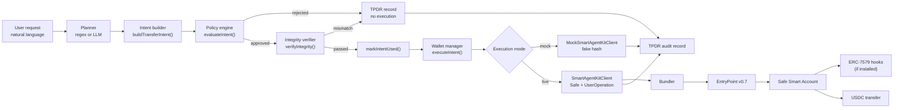
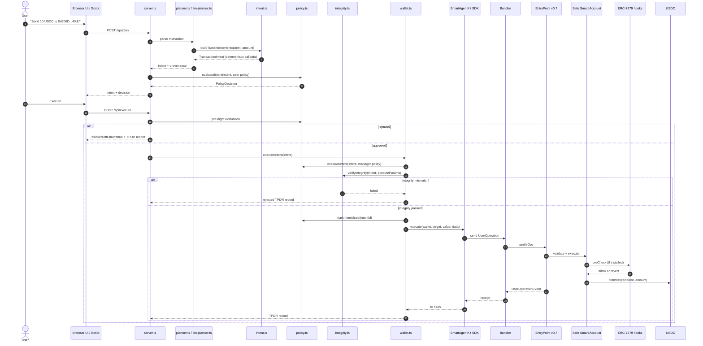
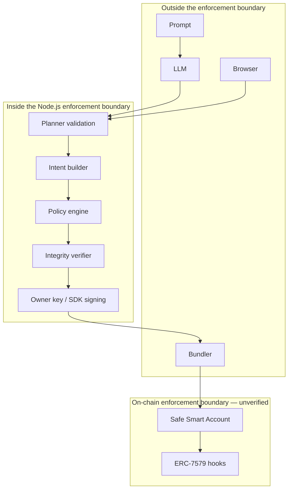
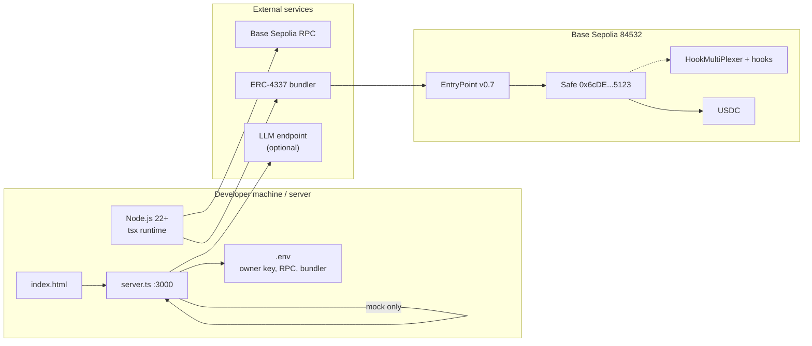

# Sentinel Wallet — Architecture and Data Flow

**Document date:** 20 October 2026  
**Purpose:** Explain the modules, their responsibilities, trust boundaries, and the exact path from a user request to an audit record. This document is intentionally narrower and more implementation-focused than [TECHNICAL_DOCUMENTATION.md](TECHNICAL_DOCUMENTATION.md).

---

## 1. Module Inventory

| Module | File | Key exports / functions | Responsibility |
|--------|------|-------------------------|----------------|
| Core types | `src/types.ts` | `TransactionIntent`, `PolicyDecision`, `TPDRRecord`, `IntegrityCheckResult`, `ExecutionResult` | Shared typed contracts across the pipeline |
| Intent builder | `src/intent.ts` | `buildTransferIntent()`, `generateIntentId()`, `serializeIntent()`, `hashIntent()`, `TRANSFER_SELECTOR` | Validates fields, deterministically encodes ERC-20 calldata, creates intent ID and expiry |
| Policy engine | `src/policy.ts` | `evaluateIntent()`, `markIntentUsed()`, `isIntentUsed()`, `_resetUsedIntents()`, `PolicyConfig` | Eleven deterministic pre-flight checks; in-memory replay set |
| Integrity verifier | `src/integrity.ts` | `verifyIntegrity()`, `decodeTransferCalldata()` | Compares execution inputs/calldata with the approved intent |
| Regex planner | `src/planner.ts` | `parsePlannerRequest()`, `getDemoScenarios()`, `PlannerRequest`, `PlannerResult` | Deterministic natural-language parser and scripted demo scenarios |
| LLM planner | `src/llm-planner.ts` | `parsePlannerRequestWithLLM()`, `parsePlannerRequestWithLLMFallback()`, `getLLMConfigFromEnv()`, `extractJSONFromModelOutput()` | Calls an LLM endpoint, validates typed output, falls back to regex |
| Wallet manager | `src/wallet.ts` | `SentinelWalletManager`, `MockSentinelWalletManager` | Orchestrates policy → integrity → execution → TPDR |
| Auth | `src/auth.ts` | `registerUser()`, `authenticateUser()`, `validateSession()`, `terminateSession()`, `initDemoAccount()` | Users, PBKDF2 hashing, sessions, rate limits |
| Settings | `src/settings.ts` | `maskApiKey()`, `sanitizeLLMForClient()`, `applyLLMSettingsUpdate()` | Secret masking and safe partial updates |
| HTTP API | `src/server.ts` | `handleRequest()`, `initializeManager()`, `requireSession()`, `getClientIp()`, `isAllowedOrigin()`, `policyConfigForUser()` | REST routes, CSRF/IP checks, per-user settings, mock manager |
| Mock demo | `src/demo.ts` | Mock/live demo runners | Scripted end-to-end demonstration |
| Live demo | `scripts/live-test.ts` | Demo + real transfer attempt | Historical on-chain evidence generator |
| Safe inspector | `scripts/inspect-safe.ts` | Read-only Safe/EntryPoint/registry checks | Diagnostics without state changes |
| Safe recovery | `scripts/recover-safe-7579.ts` | Dry-run `setFallbackHandler`; `--broadcast` opt-in | Repairs the Safe7579 fallback handler |
| Browser UI | `sentinel-wallet-ui/index.html` | Auth, dashboard, plan/execute, settings, audit views | Client for the REST API |

---

## 2. Request-to-Execution Data Flow

### 2.1 High-level flow



### 2.2 Exact function path (mock REST flow)

```
Browser fetch POST /api/plan
  → server.ts route handler
  → parsePlannerRequest() or parsePlannerRequestWithLLMFallback()
  → buildTransferIntent()                         [src/intent.ts]
  → evaluateIntent(intent, policyConfigForUser()) [src/policy.ts]
  → JSON response { intent, decision, planner }

Browser fetch POST /api/execute
  → requireSession()                              [src/server.ts]
  → evaluateIntent(intent, userPolicy)            [pre-flight]
  → manager.updatePolicyConfig(...)               [global mock manager]
  → MockSentinelWalletManager.executeIntent()     [src/wallet.ts]
      → evaluateIntent(intent, currentConfig)     [authoritative local check]
      → verifyIntegrity(intent, executeParams)    [src/integrity.ts]
      → markIntentUsed(intent.intentId)           [src/policy.ts]
      → MockSmartAgentKitClient.execute()         [in-memory simulation]
      → append TPDRRecord                         [in-memory array]
  → JSON response { success: true, record }
```

### 2.3 Exact function path (live script flow)

```
scripts/live-test.ts
  → parsePlannerRequestWithLLMFallback()          [optional LLM]
  → new SentinelWalletManager({ ownerKey, ... })
  → manager.connectWallet(existingSafe) or deployWallet()
  → manager.executeIntent(intent)                 [src/wallet.ts]
      → evaluateIntent()
      → verifyIntegrity()
      → markIntentUsed()
      → SmartAgentKitClient.execute(wallet, { target, value, data })
          → build UserOperation
          → sign with owner key
          → submit to bundler
          → EntryPoint.handleOps()
          → Safe execution (if configured)
      → append TPDRRecord
```

---

## 3. Sequence Diagram — Full Intended Path



**Reality check:** the server branch uses `MockSmartAgentKitClient`, so the bundler/EntryPoint/Safe/Hooks/Token interactions do not occur in the browser demo. The live script branch can reach them, but the Safe is currently misconfigured and no UserOperation has been confirmed.

---

## 4. Trust Boundaries

### 4.1 Trusted vs untrusted components

| Component | Trust level | Why |
|-----------|-------------|-----|
| Natural-language prompt | Untrusted | Attacker-controlled text |
| LLM output | Untrusted | Can hallucinate or be prompt-injected |
| Regex parser output | Untrusted as intent source | Pattern matching can select an approved alias; still policy-checked |
| Browser client | Untrusted | Can send arbitrary JSON to the API |
| Session token | Semi-trusted | Random, validated, but in-memory and bearer/cookie based |
| Intent builder | Trusted for encoding | Deterministic; no external input beyond validated fields |
| Policy engine | Trusted for enforcement | Deterministic local code; not cryptographic against owner |
| Integrity verifier | Trusted for pre-submission check | Deterministic comparison; scope ends at `execute()` inputs |
| Wallet manager | Trusted for orchestration | Holds owner key in live mode |
| Server environment | Trusted | Holds `OWNER_PRIVATE_KEY` and LLM keys |
| Bundler | Untrusted for liveness and ordering | Can censor/delay; cannot forge the owner signature |
| EntryPoint | Trusted protocol contract | Canonical v0.7 address; validates signatures/nonces |
| Safe | Trusted smart account | Deployed 1.4.1 proxy; configured threshold 1 |
| ERC-7579 hooks | Intended trust anchor | Bytecode deployed; installation/enforcement unverified |
| USDC | Trusted external token | Canonical Base Sepolia USDC address |
| TPDR log | Not tamper-evident | In-memory array; no hash chain or signature |

### 4.2 Boundary diagram



**Key architectural point:** once the owner key signs, the Node.js boundary is no longer authoritative. Only the Safe/hook boundary can constrain a malicious owner or a compromised signing process. That boundary is not verified.

---

## 5. Local Enforcement vs On-Chain Enforcement

| Control | Local enforcement | On-chain enforcement | Where it must ultimately live |
|---------|-------------------|----------------------|-------------------------------|
| Chain ID | `checkChainId()` | Chain is implicit in the connected client | Local is sufficient for the agent path |
| Wallet binding | `checkWalletBinding()` | Safe address is the execution context | On-chain by construction |
| Intent expiry | `checkIntentExpiry()` | Not enforced on-chain | Local for agent autonomy; on-chain session key expiry for stronger guarantees |
| Intent replay | `usedIntentIds` Set | EntryPoint nonce | On-chain nonce is authoritative |
| Amount positivity | `checkAmountPositive()` | Token transfer semantics | Local |
| Selector allowlist | `checkSelectorMatch()` | `AllowlistHook` target+selector (intended) | On-chain |
| Calldata integrity | `checkCalldataIntegrity()` + `verifyIntegrity()` | Signature over UserOp; hooks see final calldata | On-chain hooks must validate final calldata |
| Recipient allowlist | `checkRecipientAllowlist()` | `AllowlistHook` (intended) | On-chain |
| Daily limit | `checkSpendingLimit()` | `SpendingLimitHook` (intended) | On-chain |
| Per-tx ceiling | `checkPerTxCeiling()` | No hook | Local unless a hook is added |
| Pause | `checkWalletPaused()` + user flag | `EmergencyPauseHook` (intended) | On-chain |
| Owner authorization | Owner key signs | Safe threshold/signature validation | On-chain |
| Guardian authority | Not in API | `EmergencyPauseHook` guardian (intended) | On-chain |

### 5.1 Why local-only controls are insufficient

A local check only protects requests that go through the local pipeline. It does not protect against:

- direct owner-key signing;
- a compromised server process;
- a different client calling the SDK;
- a process restart that clears the replay/spend state;
- a second server instance with its own state.

The architecture should therefore be described as **defense in depth with an unverified on-chain backstop**, not as an on-chain-enforced wallet today.

---

## 6. Data Stores and State

| State | Location | Scope | Durable? |
|-------|----------|-------|----------|
| Used intent IDs | `policy.ts` module-level `Set` | Process | No |
| Session spend | `MockSentinelWalletManager.spentThisSession` | Process/global | No |
| Policy config | `MockSentinelWalletManager.policyConfig` | Process/global | No |
| TPDR log | `MockSentinelWalletManager.tpdrLog` | Process/global | No |
| Users | `auth.ts` `users` Map | Process | No |
| Sessions | `auth.ts` `sessions` Map | Process | No |
| Login/registration rate limits | `auth.ts` Maps | Process | No |
| Per-user settings | `server.ts` `userSettingsMap` | Process | No |
| LLM settings | `server.ts` `settings.llm` | Process | No |
| Owner key | Environment / process memory | Process | No (outside DB) |
| On-chain Safe/hook state | Base Sepolia | Chain | Yes |

**Implication:** a restart resets all off-chain policy, replay, session, and audit state. The on-chain state (Safe, hooks, balances) persists, but the off-chain audit trail does not.

---

## 7. Module Responsibilities in Detail

### 7.1 `src/intent.ts` — anti-injection boundary

`buildTransferIntent()` is the only function that creates a `TransactionIntent`. It:

1. validates `walletAddress`, `tokenAddress`, and `recipient`;
2. rejects `amount <= 0n`;
3. normalizes addresses with `getAddress()`;
4. calls `encodeFunctionData({ abi: ERC20_TRANSFER_ABI, functionName: "transfer", args: [recipient, amount] })`;
5. asserts the derived selector is `0xa9059cbb`;
6. generates `intentId` with `crypto.getRandomValues(new Uint8Array(32))`;
7. sets `expiresAt = now + ttlSeconds` (`ttlSeconds` default 300);
8. records `proposedBy` and `reason`.

The builder does not accept calldata, a target other than the token, or a custom selector.

### 7.2 `src/policy.ts` — deterministic decision

`evaluateIntent()` runs all checks and returns the first failure. It does not call the network and does not sign. `spentSoFar` is supplied by the caller; the manager supplies its in-memory counter, and the server supplies that same counter through `policyConfigForUser()`.

### 7.3 `src/integrity.ts` — pre-submission comparison

`verifyIntegrity()` checks:

- `chainId`;
- `walletAddress`;
- `targetContract`;
- `calldata` equality;
- if calldata differs, decodes `transfer(address,uint256)` and checks `recipient`, `amount`, and `selector`.

Scope limit: it verifies the arguments passed to `client.execute()`, not the final signed UserOperation. SDK 0.1.10 does not expose the signed UserOp before submission.

### 7.4 `src/wallet.ts` — orchestration and fail-closed execution

`SentinelWalletManager.executeIntent()`:

1. builds `currentConfig` from `policyConfig` + `spentThisSession`;
2. calls `evaluateIntent()`;
3. on rejection, appends a TPDR record and returns;
4. builds `executeParams` with `value: 0n`;
5. calls `verifyIntegrity()`;
6. on mismatch, converts the decision to `calldata_integrity` rejection and returns;
7. calls `markIntentUsed()`;
8. throws if no wallet is initialized;
9. calls `client.execute()`;
10. in strict mode, records failure and does not fall back;
11. in explicit fallback mode, sends an owner EOA ERC-20 transfer;
12. appends and returns the TPDR record.

`MockSentinelWalletManager` mirrors the pipeline with the mock client and adds `updatePolicyConfig()` / `addSpentAmount()` helpers for the server.

### 7.5 `src/server.ts` — HTTP boundary

The server:

- serves the UI at `/`;
- exposes auth, onboarding, wallet connect, status, plan, execute, TPDR log, pause/unpause, settings, and LLM test routes;
- uses a module-global `MockSentinelWalletManager`;
- seeds one TPDR record at startup (the `0xdb8c...3592` record with an inaccurate Safe description);
- validates sessions and CSRF origins;
- stores per-user settings in `userSettingsMap`;
- does not instantiate a live wallet manager and does not hold a real owner key for API execution.

### 7.6 `src/auth.ts` — identity

In-memory users and sessions, PBKDF2-SHA512 with 100,000 iterations, random 32-byte session IDs, 24-hour fixed expiry, login lockout after 5 failures for 5 minutes, registration limit of 5 per IP per 15 minutes, and opt-in demo account seeding.

### 7.7 `src/settings.ts` — secret display boundary

`maskApiKey()` preserves only the last four characters; `sanitizeLLMForClient()` removes `apiKey` and adds `apiKeyMasked`; `applyLLMSettingsUpdate()` refuses to persist masked placeholders and supports explicit clearing with `apiKey: null`. Sixteen tests cover this behavior.

---

## 8. Failure Paths and Their Data Flow

### 8.1 Planner failure

```
parsePlannerRequest() → { success: false, error }
  → no buildTransferIntent()
  → no policy decision
  → no TPDR record (the API returns an error)
```

The LLM fallback wrapper attempts regex before returning failure.

### 8.2 Policy rejection

```
evaluateIntent() → { status: "rejected", failedCheck, checks }
  → executeIntent() appends { intent, decision, recordedAt }
  → returns without executing
```

The server's `/api/execute` pre-check also appends a rejected record and returns `{ success: false, blockedOffChain: true }`.

### 8.3 Integrity rejection

```
verifyIntegrity() → { passed: false, mismatchedField }
  → decision becomes rejected with failedCheck = "calldata_integrity"
  → TPDR record includes integrityCheck
  → no markIntentUsed(), no execute()
```

### 8.4 Safe/bundler failure (strict)

```
client.execute() throws
  → strictSafeMode === true
  → execution = { success: false, error: "Safe UserOp execution failed (strict fail-closed): ..." }
  → no txHash
  → no spend increment
  → TPDR record includes failure
```

### 8.5 Safe/bundler failure (explicit fallback)

```
client.execute() throws
  → SENTINEL_STRICT_SAFE=explicit-eoa-fallback
  → console.warn with the real error
  → owner EOA writeContract(transfer)
  → waitForTransactionReceipt
  → execution = { success: true, txHash }
```

This path is a demo escape hatch, not Safe execution.

### 8.6 Mock execution

```
MockSmartAgentKitClient.execute()
  → enforceNotPaused()
  → enforceAllowlist()
  → optional spending deduction
  → fakeTxHash()
  → return random hash
```

No chain, no UserOperation, no receipt.

---

## 9. Where Enforcement Must Move On-Chain

For the system to make the competition's strongest claim — an autonomous wallet whose limits survive a compromised agent or owner — the following must be enforced by the Safe/hooks, not only by TypeScript:

1. **Recipient allowlist** must be checked against the final calldata in `AllowlistHook`.
2. **Daily/per-token spending** must be recorded in `SpendingLimitHook`.
3. **Pause state** must be checked by `EmergencyPauseHook`.
4. **Selector/target restrictions** must reject non-transfer calls and protected targets.
5. **Module installation/delegatecall** must be blocked by the hooks.
6. **Replay** must be enforced by the EntryPoint nonce (and/or a scoped session key nonce).
7. **Owner authority** should be a threshold/multisig or a scoped session key, not a single EOA.

Today, items 1–6 are implemented off-chain and intended on-chain; item 7 is a single owner key. The on-chain half is the critical remaining engineering work.

---

## 10. Deployment View



The mock server path terminates inside `server.ts`; the live script path is the only path that currently reaches the chain.

---

## 11. Design Decisions and Trade-offs

| Decision | Rationale | Cost |
|----------|-----------|------|
| Typed intent instead of raw calldata | Removes the agent's ability to inject arbitrary calls | Only ERC-20 `transfer` is supported |
| Deterministic policy engine | Reproducible, auditable, no model dependency | Cannot judge business legitimacy |
| LLM optional, regex fallback | Demo works offline; LLM is not a dependency | LLM path is not always exercised |
| Strict Safe mode by default | Prevents misleading EOA fallback | Live demo fails when Safe is misconfigured |
| In-memory state | Simple prototype, no DB setup | No durability, no multi-process safety |
| Shared mock manager | Simple UI demo | Weak multi-user execution isolation |
| Owner key signing | Simplest SDK integration | No scoped delegation; single point of failure |
| Separate UI file served by API | No build step | UI is tightly coupled to API path |

---

## 12. Summary

- **Implemented and tested:** typed intents, deterministic policy, calldata integrity, planner validation, auth/CSRF/IP controls, per-user settings, mock pipeline, fail-closed Safe handling.
- **Implemented but not verified live:** Safe deployment/connect, UserOperation submission, hook enforcement, pause/unpause.
- **Not implemented:** scoped session keys, durable state, per-user execution isolation, cryptographic audit records, on-chain per-tx ceiling.
- **Current chain reality:** a deployed Safe with a missing Safe7579 fallback handler, zero EntryPoint nonce, hooks not proven installed, and two confirmed owner EOA USDC transfers.

See [TESTING_AND_EXECUTION_EVIDENCE.md](TESTING_AND_EXECUTION_EVIDENCE.md) for the transaction-level proof and [SECURITY_SELF_ASSESSMENT.md](SECURITY_SELF_ASSESSMENT.md) for the risk register.
