# Sentinel Wallet — Security Self-Assessment

**Document date:** 20 October 2026  
**Scope:** `sentinel-wallet/` source, tests, scripts, configuration templates, and the deployed Base Sepolia state that could be read without changing it  
**Assessment type:** self-assessment for competition submission, not a third-party audit  
**Overall conclusion:** The off-chain prototype is thoughtfully layered and its deterministic policy/integrity pipeline is covered by 165 passing automated tests. The system is **not production-ready**, is **not fully secure**, and the on-chain enforcement path is **not verified**. Several demo-integrity issues and at least one credential-hygiene issue require action before submission.

> This document deliberately avoids the phrases "fully secure" and "production-ready." No such claim is supported by the evidence.

---

## 1. Assets Being Protected

| Asset | Why it matters | Current protection |
|-------|----------------|--------------------|
| Safe Smart Account funds (USDC and any future tokens) | Direct financial loss | Intended ERC-7579 hooks; off-chain policy pre-flight; not verified on-chain |
| Owner EOA private key | Full control over the Safe and any fallback transfer | Environment variable; process memory; no KMS/HSM; no scoped delegation |
| Guardian authority | Emergency pause/unpause | Intended `EmergencyPauseHook`; local API pause flag; on-chain path unverified |
| Approved recipient list | Prevents payments to attacker addresses | Off-chain allowlist; intended `AllowlistHook` |
| Spending limits | Limits loss per day/transaction | Off-chain daily limit and per-tx ceiling; intended `SpendingLimitHook` |
| Intent integrity | Prevents calldata substitution | Deterministic encoding + pre-submission comparison; not cryptographic after signing |
| Audit records | Accountability and reconstruction | In-memory TPDR records; no durability or tamper evidence |
| User credentials and sessions | Prevent account takeover | PBKDF2-SHA512, random session tokens, rate limits; in-memory store |
| LLM API key | Prevents unauthorized model usage and cost | Server-side only; masking on client responses; but a key-like value exists in `.env.example` |
| Demo credibility | Judges must be able to trust claims | Currently undermined by mock hashes labeled as on-chain and a misattributed seeded transaction |

---

## 2. Threat Model and Attacker Assumptions

### 2.1 Attacker capabilities considered

1. **Prompt injection / malicious user instruction.** The attacker controls the natural-language text and tries to make the agent send funds to an unapproved address, exceed limits, or invoke a non-transfer function.
2. **Compromised or hallucinating LLM.** The model returns a malicious recipient, an excessive amount, malformed JSON, or injected calldata.
3. **Compromised dependency or SDK.** A library mutates the target, calldata, or amount between approval and submission.
4. **Malicious bundler.** The bundler censors, delays, reorders, or attempts to substitute a UserOperation.
5. **Compromised owner key.** The attacker obtains `OWNER_PRIVATE_KEY` and signs directly.
6. **Unauthenticated or cross-tenant web attacker.** The attacker probes the REST API, forges cookies, bypasses CSRF, spoofs `X-Forwarded-For`, or accesses another user's policy/audit data.
7. **Malicious guardian impersonation.** The attacker tries to pause/unpause or rotate the guardian.
8. **Replay attacker.** The attacker resubmits a previously approved intent or UserOperation.
9. **Insider/operator error.** A demo operator runs the wrong script, broadcasts a fallback EOA transfer, or presents mock output as chain evidence.
10. **Credential scavenger.** The attacker reads repository templates, logs, or archives for secrets.

### 2.2 Out of scope

- Consensus-level attacks on Base Sepolia.
- Compromise of the USDC contract or the Safe singleton implementation.
- Physical coercion of the owner.
- Side-channel attacks on the Node.js process.
- Regulatory/compliance suitability of the payment use case.
- Source-code equivalence of the deployed hook bytecode to a specific audited commit (not verified here).

### 2.3 Security assumptions

- Base Sepolia RPC and the configured bundler are honest-but-curious; the bundler may censor but cannot forge the owner's ECDSA signature.
- The owner key is generated and stored outside the repository.
- The policy engine process is not simultaneously compromised by the same attacker who controls the prompt; if it is, off-chain checks provide no protection.
- The on-chain hooks are correctly deployed and installed. **This assumption is currently unverified and is the largest gap.**
- The Safe owner set and threshold are correct. Read-only inspection shows one owner and threshold 1, which is a single point of failure.

---

## 3. Trust Boundaries

```mermaid
flowchart LR
    subgraph UNTRUSTED["Untrusted"]
        P["Natural-language prompt"]
        LLM["LLM output"]
        WEB["Browser client"]
        NET["Public network / bundler"]
    end

    subgraph SEMI["Semi-trusted / authenticated"]
        USER["Authenticated web user"]
        SESSION["Session cookie / bearer token"]
    end

    subgraph TRUSTED["Trusted for enforcement"]
        POLICY["Policy engine<br/>src/policy.ts"]
        INTENT["Intent builder<br/>src/intent.ts"]
        TPDR["Integrity verifier<br/>src/integrity.ts"]
        WALLET["Wallet manager<br/>src/wallet.ts"]
        ENV["Server environment<br/>owner key"]
    end

    subgraph CHAIN["On-chain trust anchor — intended"]
        SAFE["Safe Smart Account"]
        HOOKS["ERC-7579 hooks"]
        EP["EntryPoint v0.7"]
    end

    P --> LLM
    LLM -->|"typed recipient/amount"| POLICY
    WEB --> USER
    USER --> SESSION
    SESSION --> POLICY
    POLICY --> INTENT
    INTENT --> TPDR
    TPDR --> WALLET
    WALLET --> ENV
    WALLET --> NET
    NET --> EP
    EP --> SAFE
    SAFE --> HOOKS
```

**Boundary interpretation:**

- The LLM is outside the trust boundary. Its output is schema-validated and then policy-checked.
- The browser is untrusted. It can submit arbitrary intent JSON to `/api/execute`.
- The local policy engine and intent builder are trusted for enforcement, but only within the Node process. They do not constrain a party who holds the owner key.
- The on-chain boundary is the only boundary that can constrain a compromised owner key. It is currently unverified.

---

## 4. Owner Authorization and Signing Responsibilities

### 4.1 Current model

- `SentinelWalletManager` stores `ownerKey` and calls `SmartAgentKitClient.connectWallet(walletAddress, ownerKey)` / `createWallet({ ownerPrivateKey: ownerKey, ... })`.
- `client.execute()` signs the UserOperation with the owner key.
- `pauseWallet(guardianKey)` and `unpauseWallet(guardianKey)` also require a key; in the demo the guardian equals the owner.
- The browser/API flow does not sign anything; the server uses the mock client.

### 4.2 What the owner can do

The owner can:

- deploy or connect the Safe;
- sign any UserOperation directly, without the planner or policy engine;
- call owner-only Safe functions;
- pause/unpause if the guardian is the owner;
- change or remove modules if the Safe threshold allows it;
- send a direct ERC-20 transfer from the owner EOA, bypassing the Safe entirely.

### 4.3 Consequence

The policy engine is **not** a cryptographic restriction on the owner. It is an application-level guard that prevents the *agent* from submitting out-of-policy intents through this pipeline. A compromised owner key defeats every off-chain control and can only be constrained by correctly installed on-chain hooks and Safe configuration.

### 4.4 Session keys

The current code does **not** use a scoped session key. The SDK supports `createSession()`, but `src/wallet.ts` explicitly documents that it is unused. Any statement that the agent uses a scoped session key is incorrect.

---

## 5. Policy Enforcement and Permission-Tier Design

### 5.1 Enforcement layers

| Layer | What it does | Bypass conditions | Verification |
|-------|--------------|-------------------|--------------|
| Intent schema | Limits planner output to recipient/amount/token | None for the typed path; a caller can bypass the planner and call `/api/execute` directly | Unit tests |
| Intent builder | Re-encodes calldata from validated fields | A caller who never uses the builder | Unit tests |
| Policy engine | Eleven deterministic checks | Direct signing; editing the server process; calling the SDK outside this pipeline | 40 policy tests + 22 security tests |
| Integrity verifier | Compares execute() inputs with the approved intent | Mutation after the check, inside the SDK/signing step | 12 integrity tests |
| Safe + hooks | Intended EVM-level enforcement | Not verified; possibly not installed | On-chain inspection shows blockers |

### 5.2 Permission tiers

| Tier | Credential | Authority | Residual risk |
|------|------------|-----------|---------------|
| Owner | EOA private key | Full | Single key; no multisig/threshold >1 |
| Guardian | EOA key/address | Pause/unpause (intended) | Equals owner in demo; on-chain role unverified |
| Agent | None (intents only) | Propose transfers | Can be prompt-injected, but policy should reject |
| Web user | Session token | Manage own settings; use shared mock manager | Global manager/audit log; no per-user execution isolation |
| LLM provider | API key | Return text | Untrusted output; schema + policy |

### 5.3 Fail-closed design

- Planner failure → no intent.
- Policy failure → rejected record, no execution.
- Integrity failure → rejected record, no execution.
- Safe/bundler failure in strict mode → `success=false`, no owner fallback, no spend counted.
- Missing wallet → exception before execution.

The strict-mode default is a genuine security improvement over the earlier behavior that silently fell back to an owner EOA transfer.

---

## 6. Recipient/Target and Spending-Limit Validation

### 6.1 Recipient and target

- `checkRecipientAllowlist()` lowercases both sides and requires exact membership.
- `checkCalldataIntegrity()` requires `intent.targetContract === intent.tokenAddress`; a transfer selector sent to a hook or arbitrary contract is rejected.
- `checkSelectorMatch()` requires `0xa9059cbb`.
- `buildTransferIntent()` normalizes and validates addresses with viem.
- The agent never supplies `calldata`; the LLM schema has no calldata field.

**Residual risk:** the allowlist is only as good as its configuration. The server allows an authenticated user to set any 42-character `0x` string as the allowlist via `POST /api/settings` or onboarding. There is no second-person approval or on-chain allowlist update in the API flow.

### 6.2 Spending limits

- Daily limit: `amount <= dailyLimitAmount - spentSoFar`.
- Per-transaction ceiling: `amount <= perTxCeilingAmount` when configured.
- `spentSoFar` is in-memory and process-global in the server; it is not read from `SpendingLimitHook.getRemainingAllowance()`.
- A restart resets the counter. A second process has an independent counter.
- The on-chain `SpendingLimitHook` is intended to be authoritative but is not verified installed.

**Residual risk:** an attacker who can restart the process or call the SDK directly can reset or bypass the local daily counter. The only robust limit would be the on-chain hook.

### 6.3 Emergency pause

- The API pause is a per-user boolean. It stops intents through that user’s policy path.
- It does not pause the Safe, does not call the hook, and does not prevent direct owner signing.
- `SentinelWalletManager.pauseWallet()` exists but is not exposed by the server.

---

## 7. Replay, Unauthorized Execution, Malicious Intent, and Prompt-Injection Risks

### 7.1 Replay

| Vector | Control | Gap |
|--------|---------|-----|
| Same intent ID submitted twice | In-memory `Set<string>` checked by `intent_id_replay`; marked before execution | Resets on restart; not shared across processes |
| Same UserOperation replayed | EntryPoint nonce (intended) | No UserOperation has been confirmed; nonce 0 |
| Client mints a new intent ID | Policy accepts a fresh ID | The five-minute TTL is client-supplied on `/api/execute`; a caller can set a future expiry |
| Cross-user replay | Global Set | A used ID is global, which prevents replay but also couples users |

### 7.2 Unauthorized execution

- Unauthenticated requests are rejected on protected routes by `requireSession()`.
- Cookie-authenticated POSTs require an allowed `Origin`; missing, `null`, or disallowed origins return 403.
- Bearer tokens are accepted without an Origin check because they are non-ambient credentials.
- The mock server has no real signing authority, so unauthorized on-chain execution is not possible through the API in the current configuration.
- In live mode, anyone with the owner key can execute directly; the API is irrelevant to that attacker.

### 7.3 Malicious intent

The policy engine checks structure and destination, but it cannot determine whether a payment is *business-legitimate*. A recipient that is on the allowlist and within the limit will be approved even if the underlying invoice is fraudulent. This is an authorization design choice, not a bug; it should be stated to judges.

### 7.4 Prompt injection

**Contained by design:**

- The LLM output is constrained to JSON with `action`, `recipient`, `amount`, `token`.
- Calldata is never accepted from the model.
- Address, amount, and token are validated before intent construction.
- Policy checks run independently of the planner.
- A prompt-injected recipient not on the allowlist is rejected; an over-limit amount is rejected.

**Not contained:**

- An injection that names an allowlisted recipient and an amount within the limit will be approved. The policy cannot know the user’s true intent.
- The regex planner has hard-coded aliases that map phrases like "approved recipient" or "vendor #481" to a fixed address. A prompt can use those aliases to select the approved recipient, which is not an escalation but is a demo-specific behavior.
- The LLM system prompt says to ignore rule-changing instructions, but prompt-injection resistance of the model itself is not claimed or tested adversarially beyond schema validation.

**Verified tests:** `llm-planner.test.ts` covers malformed output, wrong token, invalid address, invalid amount, no-intent-on-failure, and regex fallback. `security.test.ts` covers unapproved recipient, over-limit, selector abuse, pause, expiry, replay, wrong chain, wrong wallet, and tampered calldata.

---

## 8. Key Management and Secrets Handling

### 8.1 Current handling

| Secret | Storage | Exposure surface | Assessment |
|--------|---------|------------------|------------|
| `OWNER_PRIVATE_KEY` | `.env` (git-ignored) and process memory | Node process, scripts, crash logs if printed | No KMS/HSM; full custody; rotate if ever logged |
| `LLM_API_KEY` | `.env` / `src/server.ts` settings object | Server-side; masked for clients | Masking is tested; still plaintext in memory |
| Session tokens | In-memory `Map` | HTTP cookie or bearer token | Random 32 bytes; no persistence |
| Passwords | PBKDF2-SHA512, 100k iterations, per-user salt | Never returned | Reasonable prototype hashing; no Argon2/scrypt |
| Demo account password | Environment variable or hard-coded fallback | UI quick-demo button contains the fallback password | Must not be enabled in production |
| Provider/RPC keys | `.env` | Server/scripts | Not committed if `.gitignore` is honored |

`.gitignore` excludes `.env`, `.env.*` (with `!.env.example`), `keys.json`, `mini-freellm/keys.json`, logs, and `freellmapi/`.

### 8.2 Concrete finding: credential-like value in `.env.example`

`sentinel-wallet/.env.example` contains a non-empty `LLM_API_KEY` value in the format of a real provider credential. This file is tracked and is intended to be copied by users. Publishing a real key in a template is a secret leak regardless of whether the key is currently active.

**Required action:** rotate/revoke that credential and replace the value with an empty placeholder such as `LLM_API_KEY=`. Do not reproduce the key in documentation, slides, or the demo video. Check git history and the audit ZIP before publishing the repository.

### 8.3 Other secret-handling observations

- `src/server.ts` contains a well-known Foundry test private key. It is used only by the offline mock manager and has no funds on a public network, but it should still be labeled clearly as test-only.
- The UI's "Quick Demo Login" button contains a hard-coded demo password. The backend disables the demo account unless `ENABLE_DEMO_ACCOUNT=true`, and refuses the default password in `NODE_ENV=production`. This is a reasonable gate, but the client-side password should not be presented as a production feature.
- No secret values are included in these competition documents.

---

## 9. API Authentication, CSRF, IP Controls, and Multi-User Isolation

Only behaviors confirmed in code and tests are listed.

### 9.1 Authentication

| Control | Implementation | Verified |
|---------|----------------|----------|
| Password hashing | PBKDF2-SHA512, 100,000 iterations, 16-byte salt, 64-byte output | `auth.test.ts` (9 tests) |
| Password comparison | `timingSafeEqual` | Code review; tests cover login success/failure |
| Session token | `crypto.randomBytes(32).toString("hex")` | Code review; tests check distinct tokens |
| Session lifetime | Fixed 24 h `expiresAt` | Code review; not a sliding idle timeout despite the header comment |
| Logout | Deletes session and clears cookie | `auth.test.ts` |
| Login rate limit | 5 failures per IP → 5-minute lockout | `auth.test.ts` |
| Registration rate limit | 5 accounts per IP per 15 minutes | `auth.test.ts` |
| Demo account | Disabled unless `ENABLE_DEMO_ACCOUNT=true`; production requires explicit password | `auth.test.ts` (4 tests) |

**Gaps:** users and sessions are in memory; there is no email verification, password reset, MFA, account lockout persistence, or session revocation across processes. Registration can be abused to create many accounts within the rate limit; there is no CAPTCHA or invite gate.

### 9.2 CSRF

- `requireSession()` requires a valid `Origin` for every cookie-authenticated POST.
- Missing, `null`, and disallowed origins → 403.
- `localhost` and `127.0.0.1` are allowed; additional origins must be in `ALLOWED_ORIGINS`.
- Bearer-token requests skip the Origin check.
- Logout duplicates the Origin check.
- The session cookie is `HttpOnly; SameSite=Lax` but **not `Secure`** in the current code. That is acceptable for local HTTP demos, not for production HTTPS.

**Verified:** `csrfAndIpTrust.test.ts` covers missing/null/disallowed/allowed origins and the bearer exception.

**Gap:** there is no synchronizer CSRF token; the design relies on Origin checking and SameSite. A same-site XSS or a browser that omits Origin could change the risk profile. `Access-Control-Allow-Origin: *` is set when no Origin header is present, but credentials are not allowed in that branch; this should be reviewed before exposing the API publicly.

### 9.3 IP controls and proxy trust

- `getClientIp()` uses the socket address.
- `X-Forwarded-For` is honored only when the immediate socket address is in `TRUSTED_PROXIES`.
- IPv6-mapped IPv4 addresses are normalized.
- Changing `X-Forwarded-For` without a trusted proxy does not bypass registration rate limits.

**Verified:** `csrfAndIpTrust.test.ts` (3 IP tests).

**Gaps:** rate-limit state is in memory and per-process; there is no global rate limiter on `/api/plan`, `/api/execute`, or `/api/llm/test`. There is no IP allowlist.

### 9.4 Multi-user isolation

**Verified:** `multiUserIsolation.test.ts` (3 tests) and `httpMultiUser.test.ts` (1 integration test) show that per-user settings for daily limit, per-tx ceiling, allowlist, and pause are stored and evaluated independently for `/api/settings` and `/api/plan`.

**Not verified / gaps:**

1. `manager` is a single module-global `MockSentinelWalletManager`. `spentThisSession`, `policyConfig`, and `tpdrLog` are global.
2. `/api/execute` updates the global manager policy before every execution, so concurrent executions by different users can race.
3. `/api/tpdr-log` returns the full global log to any authenticated user; records are not filtered by user.
4. `/api/status` is unauthenticated and returns global wallet/limit/spend/hook/live-tx data.
5. `/api/wallet/connect` and `/api/onboarding/complete` mutate the global manager wallet address.
6. `GET /api/settings` is per-user, but the spent amount shown elsewhere is global.
7. There is no per-user owner key, Safe, or audit namespace.

**Assessment:** the multi-user claim is true for *settings and planning-time policy evaluation*, not for *execution isolation or audit confidentiality*.

---

## 10. Emergency Pause and Recovery Behavior

### 10.1 Current behavior

| Control | Behavior | On-chain? |
|---------|----------|-----------|
| `POST /api/pause` | Sets the authenticated user's `isPaused=true` | No |
| `POST /api/unpause` | Sets the authenticated user's `isPaused=false` | No |
| `SentinelWalletManager.setPausedState()` | Updates local policy flag | No |
| `pauseWallet(guardianKey)` | Calls SDK pause | Intended; not exposed via API |
| `EmergencyPauseHook` | Reverts all executions when paused (documented) | Intended; installation/enforcement unverified |
| Auto-unpause | Payment-agent preset documents a 1-hour timeout | Not verified in this repository |

### 10.2 Recovery

- `scripts/recover-safe-7579.ts` prepares a Safe `execTransaction` to set the Safe7579 fallback handler. It defaults to dry-run (`eth_call`) and only broadcasts with `--broadcast`.
- The script's dry-run simulation does not itself change state.
- No broadcast was performed as part of this documentation task.
- Whether the parallel on-chain agent has completed the repair is **pending verification**. Do not claim recovery until a confirmed transaction and a successful UserOperation are both available.

### 10.3 Fail-closed vs fail-open

- Off-chain failures fail closed.
- The optional `SENTINEL_STRICT_SAFE=explicit-eoa-fallback` mode is a deliberate fail-open demo path that bypasses the Safe and hooks. It should never be used in a security demonstration without a clear warning.
- The historical `live-test-run.log` used that fallback path and produced an owner EOA transfer. Presenting that transfer as Safe execution would be a false claim.

---

## 11. Test Coverage and the Difference Between Mocks and Real Chain Execution

### 11.1 What is verified

| Area | Tests | Type | What it proves |
|------|-------|------|----------------|
| Intent builder | 13 | Unit | Address/amount validation, deterministic calldata, unique IDs |
| Policy engine | 40 | Unit | All 11 checks, cumulative spend, per-tx ceiling, pause, replay |
| Integrity verifier | 12 | Unit | Tampered recipient/amount/target/calldata detection |
| Regex planner | 9 | Unit | Parsing, validation, demo scenarios |
| LLM planner | 24 | Unit | JSON extraction, schema validation, failure/fallback |
| Security scenarios | 22 | Unit + mock | Negative tests, TPDR tamper tests, concurrent replay |
| Auth/session | 9 | Unit | Hashing, sessions, rate limits, demo-account gating |
| Settings masking | 16 | Unit | API-key masking, masked-value preservation |
| CSRF/IP trust | 9 | Unit + local HTTP | Origin enforcement, proxy trust |
| Multi-user settings | 3 | Unit | Per-user policy evaluation |
| HTTP multi-user | 1 | Local HTTP integration | Settings/plan isolation over REST |
| Reconnect | 3 | Unit + mock | `connectWallet()` state reconstruction |
| Strict Safe mode | 4 | Unit + stub | Fail-closed behavior; no owner fallback by default |

**Execution result:** 13 test files, 165 tests, 165 passed, 0 failed (`npm test`, 20 October 2026). TypeScript build (`npm run build`) exit 0.

### 11.2 What is not verified

- No Foundry/forge tests are present in this repository. The hooks are external deployments.
- No fork-based tests replay mainnet/testnet state.
- No automated test submits a real UserOperation.
- No test asserts an on-chain hook revert.
- No test covers concurrent `/api/execute` calls with different users.
- No test covers a real LLM network call in CI; `vitest.config.js` clears `LLM_ENDPOINT_URL` and `LLM_API_KEY`.
- The live script's historical success was an **owner EOA fallback**, not a Safe UserOperation.

### 11.3 Mock behavior that must not be mistaken for chain behavior

`MockSmartAgentKitClient.execute()`:

- checks its own in-memory pause/allowlist/spending state;
- deducts from an in-memory token balance;
- returns `0x` + random hex from `fakeTxHash()`.

It does not call an EVM, does not produce a real transaction, and cannot be verified on BaseScan. The server always uses this mock. The UI's "On-Chain Safe Co-Signature Confirmed" text is therefore misleading.

---

## 12. Known Vulnerabilities, Unresolved Risks, and Mitigations

Severity is a self-assessment based on impact and exploitability in the current prototype.

| # | Risk | Severity | Status | Evidence | Mitigation / next step |
|---|------|----------|--------|----------|------------------------|
| 1 | Safe UserOperation path blocked; Safe7579 fallback handler unset; EntryPoint nonce 0 | **Critical** | Open / pending | On-chain reads: fallback slot `0x0`, EntryPoint nonce 0; `live-test-run.log` bundler simulation failure | Complete fallback-handler repair; verify with a real UserOperation |
| 2 | Hooks not proven installed on the displayed Safe; `isModuleEnabled(HMP)=false`; `isModuleInstalled(4,...)` reverts | **Critical** | Open / unverified | Read-only RPC queries | Install hooks via Safe7579, record installation tx, read back configuration |
| 3 | No confirmed on-chain enforcement (no hook revert) | **Critical** | Unverified | No `handleOps` tx or revert in logs | Submit an intentionally over-limit/unapproved UserOp and capture the revert |
| 4 | Owner EOA fallback bypasses Safe and hooks | **High** | Mitigated by default strict mode; opt-in remains | `src/wallet.ts`; `safe-strict-mode.test.ts`; historical log | Keep strict default; never demo fallback as Safe execution; consider removing fallback entirely |
| 5 | Owner key is a single point of control; no scoped session key | **High** | Open | `src/wallet.ts` comment; signing model | Move to scoped session key/module permission; use multisig/threshold >1 for production |
| 6 | Browser/REST demo is mock-only but UI claims on-chain confirmation and links random hashes | **High** | Open | `src/server.ts` imports only `MockSentinelWalletManager`; `fakeTxHash()`; UI lines ~1698–1720 | Label as simulation; remove BaseScan links for mock hashes; gate "live" UI behind a real backend |
| 7 | Seeded TPDR record claims tx `0xdb8c...3592` is Safe co-signed; on-chain it is a direct EOA transfer | **High** | Open | `src/server.ts` lines 99–161; RPC tx `from` = owner EOA, `to` = USDC, no `handleOps` | Correct the record and `/api/status` text; disclose the EOA nature in the demo |
| 8 | Multi-user isolation is partial: global manager, spent counter, wallet address, audit log | **High** | Partially mitigated | `src/server.ts` module-global `manager`; tests cover settings/plan only | Per-user manager/account namespace; filter audit; add concurrent execution tests |
| 9 | `/api/execute` trusts client-supplied `expiresAt`, `intentId`, `proposedBy`, and `reason` | **Medium** | Open | `src/server.ts` `/api/execute` | Server-side intent store with server-generated ID/expiry; bind to a signed plan token |
| 10 | `/api/status` unauthenticated; `/api/tpdr-log` global to any authenticated user | **Medium** | Open | `src/server.ts` | Require auth for status; filter audit by user/account |
| 11 | In-memory replay/spend/settings/sessions/audit; restart resets and multi-process diverges | **Medium** | Open | `src/policy.ts`, `src/auth.ts`, `src/server.ts` | Durable DB with unique constraints and transactional spend accounting |
| 12 | TPDR is not cryptographic; "tamper-evident" is overstated | **Medium** | Open | `src/types.ts`, `src/integrity.ts` | Hash-chain/sign records; store signed intent + UserOp hash |
| 13 | `.env.example` contains a credential-like `LLM_API_KEY` value | **High** | Open | `.env.example` | Rotate the key; replace with empty placeholder; purge from history/archive |
| 14 | LLM API key stored plaintext in memory; settings masking is heuristic | **Medium** | Mitigated for client exposure | `src/settings.ts`; 16 tests | Use a secrets manager; avoid storing user-provided keys server-side |
| 15 | LLM settings saved by UI are not used by the planner (env-only) | **Low/Medium** | Open | `src/server.ts` uses `llmEnv` | Wire per-user config or remove misleading settings |
| 16 | Cookie lacks `Secure`; no CSRF token; no HTTPS enforcement | **Medium** | Accepted for local demo | `src/server.ts` `Set-Cookie` | Add `Secure`, HSTS, CSRF token, TLS termination for any public deployment |
| 17 | No rate limiting on plan/execute/llm-test; DoS/cost abuse possible | **Medium** | Open | `src/server.ts` | Add per-session/per-IP rate limits and request size limits |
| 18 | Registration/login stores are in-memory; no MFA/email verification | **Medium** | Open | `src/auth.ts` | Production identity provider; persistent store; MFA |
| 19 | Only HookMultiPlexer has a registry attestation; individual hooks fail `checkForAccount` | **Medium** | Unverified | RPC `findAttestation`/`checkForAccount` | Confirm submodule attestation model; document accepted attestation scope |
| 20 | Contract source/authority not verified in this repository; addresses come from SDK/config | **Medium** | Unverified | `README.md`, `src/wallet.ts` constants | Pin deployment manifest, verify source on BaseScan, record commit |
| 21 | Per-transaction ceiling has no on-chain equivalent | **Medium** | By design | `src/policy.ts`; docs | Add a hook if the control must survive a bypass |
| 22 | Daily limit/allowlist configurable by any authenticated user without approval | **Medium** | By design for demo | `src/server.ts` `/api/settings` | Separate policy-admin role; on-chain policy update with confirmation |
| 23 | Token wrapping / `permit` / `increaseAllowance` / multicall bypasses SpendingLimitHook | **Medium** | External limitation | `docs/security-model.md`, `README.md` | Use hook-aware wrappers or restrict token set |
| 24 | No on-chain pause from API | **Medium** | Open | `src/server.ts` `/api/pause` | Wire guardian pause tx or clearly label as local demo control |
| 25 | Guardian equals owner in demo; threshold 1 | **High** | Open | `.env` config, Safe reads | Separate guardian; multisig; threshold >1 |

---

## 13. Explicitly Unverified Contracts, Hooks, and Attestations

The following are **not** claimed as verified:

1. **Hook installation on `0x6cDE...5123`.** No installation transaction is recorded. `isModuleEnabled(HookMultiPlexer)` is `false`. ERC-7579 `isModuleInstalled(4, ...)` reverts because the Safe fallback handler is unset.
2. **On-chain policy enforcement.** No UserOperation has been observed reverting with `SpendingLimitExceeded`, `TargetNotAllowed`, `WalletPaused`, `DelegateCallNotAllowed`, or `ProtectedTargetBlocked`.
3. **SpendingLimitHook / AllowlistHook / EmergencyPauseHook source equivalence.** Bytecode exists at the documented addresses; this assessment did not verify the deployed bytecode against a specific audited Solidity commit.
4. **Individual hook attestations.** The ERC-7484 registry at `0x000000000069e2a187aeffb852bf3ccdc95151b2` has a `HookMultiPlexer` attestation by `0x000000333034E9f539ce08819E12c1b8Cb29084d` (`moduleTypes=16`, no expiration/revocation at read time). `checkForAccount(Safe, HMP)` passed. The three individual hook addresses fail `checkForAccount`; whether that is expected because they are submodules is not documented in this repository.
5. **Safe7579 module configuration.** `isModuleEnabled(Safe7579)` is `true`, but the fallback handler is `0x0`, so the ERC-7579 execution surface is not usable as configured.
6. **EntryPoint integration.** EntryPoint nonce for the Safe is `0` and its deposit is `0`; no `handleOps` transaction from this project exists in the evidence.
7. **Recovery completion.** `recover-safe-7579.ts` exists and defaults to dry-run. No broadcast was performed for this assessment. Pending verification with the parallel on-chain agent.

---

## 14. Security Test Coverage Summary

| Security property | Covered by | Result |
|-------------------|------------|--------|
| Over-limit transfer rejected | `security.test.ts` [N1] | Pass |
| Unapproved recipient rejected | `security.test.ts` [N2] | Pass |
| Admin selector / hook target rejected | `security.test.ts` [N3] | Pass |
| Paused wallet rejected | `security.test.ts` [N4] | Pass |
| Delegatecall/unsupported selector rejected | `security.test.ts` [N5] | Pass |
| Tampered recipient/amount/target | `security.test.ts` [T2–T4] | Pass |
| Expired intent rejected | `security.test.ts` [T5] | Pass |
| Replay rejected | `security.test.ts` [T6] | Pass |
| Wrong chain/wallet rejected | `security.test.ts` [T7–T8] | Pass |
| Concurrent duplicate only one approved | `security.test.ts` [S1] | Pass |
| Fail-closed Safe failure | `safe-strict-mode.test.ts` | Pass |
| CSRF origin enforcement | `csrfAndIpTrust.test.ts` | Pass |
| Proxy spoofing resistance | `csrfAndIpTrust.test.ts` | Pass |
| Per-user settings isolation | `multiUserIsolation.test.ts`, `httpMultiUser.test.ts` | Pass for settings/plan |
| API-key masking | `settings.test.ts` | Pass |
| Real on-chain hook revert | — | **Not tested** |
| Real UserOperation submission | — | **Not tested** |
| Concurrent multi-user execution | — | **Not tested** |

---

## 15. Residual Risk Statement

Sentinel Wallet demonstrates a credible architecture for constraining an AI agent: a typed intent boundary, a deterministic policy engine, a pre-submission integrity check, a Safe Smart Account target, and an audit trail. The off-chain portion is implemented and tested.

It is **not** a secure production wallet today because:

- the on-chain enforcement path is unverified and currently misconfigured;
- the owner key has unrestricted authority;
- the web demo is mock-only yet presents simulated hashes as on-chain proof;
- state and audit records are in memory;
- multi-user execution and audit isolation are incomplete;
- a credential-like value is present in a tracked template.

These are fixable engineering and documentation issues. Until they are fixed and independently verified, judges and users should treat Sentinel Wallet as a **prototype with a verified off-chain policy pipeline and an unverified on-chain enforcement layer**, not as a production custody system.
