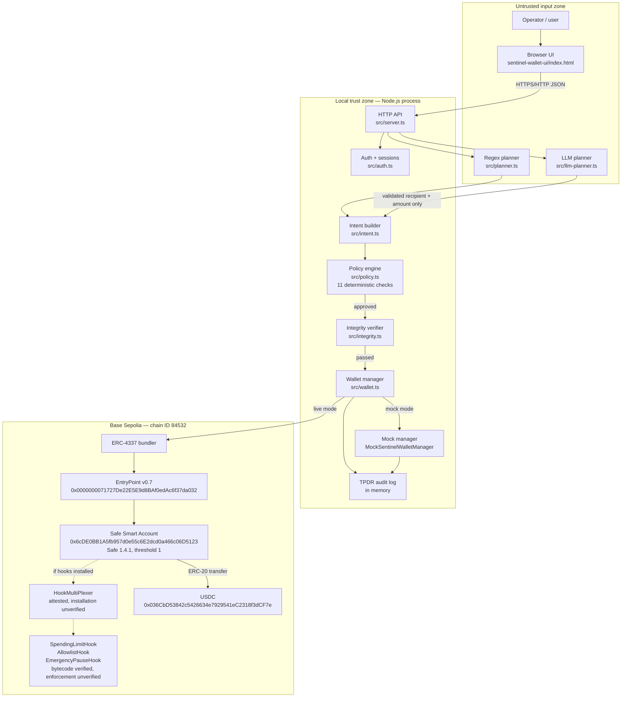
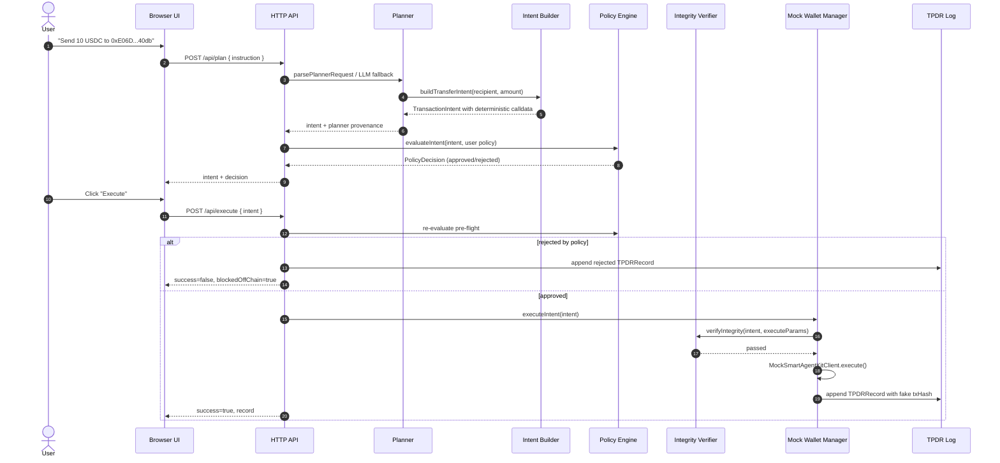
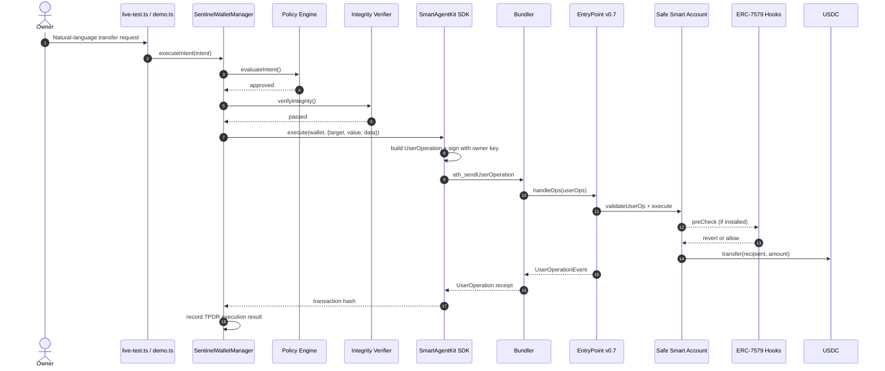
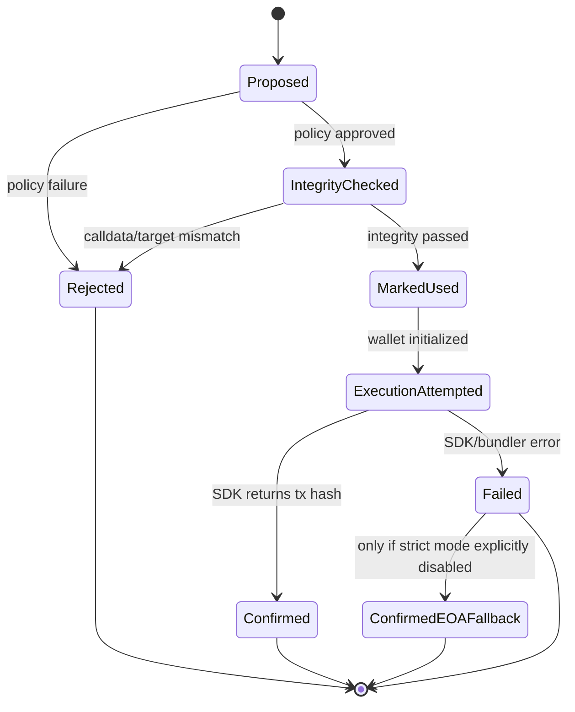

# Sentinel Wallet — Technical Documentation

**Competition:** 2026 Shenzhen International FinTech Competition — International Track  
**Topic:** F — Autonomous On-chain Wallet  
**Project:** Sentinel Wallet — an AI-powered autonomous on-chain wallet with a deterministic policy engine and Safe Smart Account integration  
**Document date:** 20 October 2026  
**Repository snapshot:** `96a7908f24dc8c95c7c8eac61259e8a309dd2c44` (`main`) plus uncommitted security work described in [TESTING_AND_EXECUTION_EVIDENCE.md](TESTING_AND_EXECUTION_EVIDENCE.md)  
**Primary evidence:** source files under `sentinel-wallet/src`, tests under `sentinel-wallet/src/__tests__`, scripts under `sentinel-wallet/scripts`, `live-test-run.log`, `mini-freellm-router.log`, and read-only Base Sepolia RPC queries performed on 20 October 2026.

> **Status statement.** This document describes a working prototype. The off-chain pipeline is implemented and covered by automated tests. The browser/REST demo is fully mocked. Two confirmed Base Sepolia transfers exist, but both are **owner EOA ERC-20 transfers**, not Safe Smart Account UserOperations. No confirmed UserOperation, no confirmed on-chain hook rejection, and no confirmed hook installation on the displayed Safe account has been verified. See [TESTING_AND_EXECUTION_EVIDENCE.md](TESTING_AND_EXECUTION_EVIDENCE.md) for the transaction-level evidence and [SECURITY_SELF_ASSESSMENT.md](SECURITY_SELF_ASSESSMENT.md) for unresolved risks.

---

## 1. Project Overview and Problem Statement

Autonomous financial agents need to move funds, but giving an AI agent an unrestricted private key creates an unacceptable blast radius. A hallucinating model, a prompt-injected instruction, a compromised dependency, or a bug in the agent can drain a wallet. The usual mitigations — asking the user to approve every transaction, or running the agent in a sandbox — either defeat autonomy or do not constrain what the agent can do on-chain.

Sentinel Wallet addresses this with a layered design:

1. **The planner is untrusted.** It may only produce a typed transfer intent containing `recipient` and `amount`. It cannot supply raw calldata.
2. **A deterministic policy engine decides.** Eleven fixed checks evaluate chain, wallet binding, expiry, replay, amount, selector, calldata integrity, recipient allowlist, daily limit, per-transaction ceiling, and pause state. The policy engine contains no LLM calls.
3. **A pre-submission integrity check re-encodes the calldata** and compares it with the approved intent before the execution call.
4. **Execution is intended to go through a Safe Smart Account and ERC-4337 UserOperation**, where ERC-7579 hooks would enforce spending limits, an allowlist, and an emergency pause at the EVM level.
5. **Every operation is recorded as a TPDR (Tamper-Evident Policy Decision Record)** for audit.

The important distinction for judges is between the **implemented and test-verified off-chain pipeline** and the **not-yet-verified on-chain enforcement path**. The project deliberately fails closed when the Safe path fails rather than silently falling back to an owner EOA transfer.

### 1.1 What the system is not

- It is not a production custody system.
- It is not a fully verified on-chain policy enforcement system.
- It is not a scoped-session-key wallet in the current implementation: the owner private key signs every UserOperation.
- The browser UI is a mock demonstration environment, not a live chain client.
- The TPDR record is not cryptographically tamper-evident; it is an in-memory TypeScript record with deterministic calldata comparison.

---

## 2. Target Users and Financial Use Case

| User | Need | How Sentinel Wallet is intended to help |
|------|------|-----------------------------------------|
| Treasury / finance operations team | Let an agent pay approved vendors within a budget | Recipient allowlist, daily limit, per-transaction ceiling, audit record |
| FinTech platform with autonomous payouts | Automate recurring payments without granting unlimited custody | Typed intents, deterministic pre-flight checks, Safe Smart Account execution path |
| DeFi or on-chain operations team | Constrain an automated bot's on-chain actions | Intent schema restricted to ERC-20 `transfer`; selector and target validation |
| Compliance / risk reviewer | Reconstruct why a payment was approved or rejected | Per-intent policy decision with all check results and execution outcome |
| Competition judge / auditor | Distinguish prototype from production | Explicit verification matrix and evidence trail |

**Primary demonstrated use case:** an operator instructs an agent in natural language to send a fixed USDC amount to an approved recipient on Base Sepolia. The agent proposes an intent; the policy engine approves or rejects it; an approved intent is executed; a TPDR record is produced.

**Supported transaction type in the current code:** ERC-20 `transfer(address,uint256)` only. Native ETH transfers and arbitrary contract calls are not supported by the policy and intent layers.

---

## 3. System Architecture and Component Responsibilities

### 3.1 Component map

| Component | File(s) | Responsibility | Status |
|-----------|---------|----------------|--------|
| Browser UI | `sentinel-wallet-ui/index.html` | Auth screens, wallet dashboard, plan/execute views, settings, audit view | Implemented; talks to mock REST API |
| HTTP API server | `src/server.ts` | REST routes, session enforcement, CSRF origin check, per-user settings, mock manager lifecycle | Implemented; mock-only execution |
| Authentication | `src/auth.ts` | Registration, PBKDF2 password hashing, session tokens, login/registration rate limits | Implemented and tested |
| Settings sanitization | `src/settings.ts` | Masks LLM API keys, prevents masked values from overwriting stored secrets | Implemented and tested |
| LLM planner | `src/llm-planner.ts` | Calls an OpenAI-compatible or Anthropic endpoint; validates model output into `(recipient, amount, token)` | Implemented and tested; optional |
| Regex planner | `src/planner.ts` | Deterministic fallback parser and scripted demo scenarios | Implemented and tested |
| Intent builder | `src/intent.ts` | Validates addresses/amount, generates intent ID, deterministically ABI-encodes calldata | Implemented and tested |
| Policy engine | `src/policy.ts` | Eleven deterministic checks; returns `PolicyDecision` | Implemented and tested |
| Integrity verifier (TPDR) | `src/integrity.ts` | Compares execution parameters and decoded calldata with the approved intent | Implemented and tested |
| Wallet manager | `src/wallet.ts` | Orchestrates policy → integrity → execution → audit; strict Safe mode | Implemented; live Safe path currently blocked |
| Mock wallet manager | `src/wallet.ts` (`MockSentinelWalletManager`) | Same pipeline using `MockSmartAgentKitClient` | Implemented and tested |
| SDK integration | `@smartagentkit/sdk` 0.1.10 | Builds/signs/submits UserOperations, connects/deploys Safe, pause/unpause | Dependency; live behavior only partially verified |
| Mock SDK | `@smartagentkit/testing` 0.1.10 | In-memory wallet, fake transaction hashes, simulated limits | Dependency; used by server and tests |
| Live evidence script | `scripts/live-test.ts` | Natural-language demo, real transfer attempt, attack demonstrations | Implemented; historical run fell back to owner EOA |
| Read-only inspector | `scripts/inspect-safe.ts` | Checks Safe deployment, modules, EntryPoint, bundler estimation, registry | Implemented; read-only |
| Safe recovery script | `scripts/recover-safe-7579.ts` | Dry-run or explicitly broadcast Safe fallback-handler repair | Implemented; dry-run by default; broadcast pending/not performed for this documentation |
| Contracts | External deployments on Base Sepolia | ERC-7579 hooks and HookMultiPlexer | Bytecode verified; installation/enforcement unverified |

### 3.2 Architecture diagram



**Legend:** solid arrows are implemented code paths. Dotted arrows are intended on-chain enforcement paths that are **not verified as installed or effective** on the displayed Safe account.

### 3.3 Deployment topology

| Mode | Entry point | Chain interaction | Current use |
|------|-------------|-------------------|-------------|
| Mock library demo | `npm run demo:mock` → `src/demo.ts` | None; `MockSmartAgentKitClient` | Verification and presentations |
| Mock REST/UI demo | `npm run dev` → `src/server.ts` + `sentinel-wallet-ui/index.html` | None; server always instantiates `MockSentinelWalletManager` | Browser demonstration |
| Live test script | `npm run live:test` → `scripts/live-test.ts` | Real Base Sepolia RPC/bundler; strict Safe mode by default | Historical run produced an owner EOA fallback transfer |
| Live deploy/execute demo | `npm run demo` → `src/demo.ts` | Real `SentinelWalletManager`, deploys a Safe, attempts a UserOperation | Not verified in this documentation |

The server does not construct `SentinelWalletManager`; it imports only `MockSentinelWalletManager`. Therefore the browser UI and REST API cannot produce a real on-chain transaction in the current code.

---

## 4. End-to-End Data Flow: Natural-Language Intent to Transaction Execution

### 4.1 Functional flow (implemented)

1. **Request ingestion.** The UI sends `POST /api/plan` with `{ instruction }`, or the live script passes a natural-language prompt directly to the planner.
2. **Planning.** `parsePlannerRequest()` (regex) or `parsePlannerRequestWithLLMFallback()` (LLM first, regex on failure) extracts `(recipient, amount)`.
3. **Intent construction.** `buildTransferIntent()`:
   - validates `walletAddress`, `tokenAddress`, and `recipient` with viem `isAddress`;
   - rejects non-positive amounts;
   - normalizes addresses to checksum form;
   - calls `encodeFunctionData()` with the ERC-20 `transfer` ABI;
   - verifies the derived selector equals `0xa9059cbb`;
   - generates a 32-byte random `intentId`;
   - sets `expiresAt = now + 300` seconds by default;
   - records `proposedBy` provenance (`llm-planner:<model>` or `simulated-planner`).
4. **Policy evaluation.** `evaluateIntent(intent, config)` runs all eleven checks and returns a `PolicyDecision`. Any failed check produces `status: "rejected"`, a stable `failedCheck`, and an advisory `riskLevel`.
5. **Approval branch.** Rejected intents are recorded in the TPDR log and are never submitted.
6. **Integrity verification.** `verifyIntegrity(intent, executeParams)` compares chain ID, wallet address, target contract, and calldata. If calldata differs, it decodes the transfer and compares recipient, amount, and selector. A mismatch sets `calldata_integrity` as the failed check and aborts.
7. **Replay marking.** `markIntentUsed(intent.intentId)` adds the ID to an in-memory `Set`.
8. **Execution.** `SentinelWalletManager.executeIntent()` calls `SmartAgentKitClient.execute(wallet, { target, value: 0n, data: calldata })`.
   - In **mock mode**, `MockSmartAgentKitClient.execute()` simulates pause/allowlist/spending checks and returns a random fake transaction hash.
   - In **live mode**, the SDK builds, signs, and submits an ERC-4337 UserOperation to the configured bundler.
9. **Audit.** A `TPDRRecord` is appended with `intent`, `decision`, `integrityCheck`, optional `execution`, and `recordedAt`.

### 4.2 Sequence diagram — verified mock path



**Important:** the mock `execute()` returns `0x` + random hex, not a chain transaction. Linking it to BaseScan is invalid. This behavior is visible in `@smartagentkit/testing/dist/index.mjs` (`fakeTxHash()`), and the server/UI demonstration should be described as simulated.

### 4.3 Sequence diagram — intended live Safe/UserOperation path



**Observed live status:** the historical `live-test-run.log` records that the Safe bundler simulation failed with a hook-related restriction and that the script fell back to a **direct owner EOA transfer**. The current code defaults to strict Safe mode and would record a failure instead of falling back. No confirmed `handleOps` transaction from this project has been observed.

### 4.4 Where the decision can change

| Stage | Can it alter recipient/amount? | Enforcement status |
|-------|-------------------------------|--------------------|
| User prompt | Yes, by definition | Untrusted input |
| LLM | It can propose a different recipient/amount, but schema validation and policy checks apply | Untrusted producer |
| Regex parser | Only parses; can be tricked by prompt text but cannot emit calldata | Untrusted producer |
| Intent builder | No; deterministically encodes validated fields | Local code |
| Policy engine | No; it only approves/rejects | Local code |
| Integrity verifier | No; it only compares | Local code |
| SDK / bundler | Theoretically could mutate a UserOp; signature validation constrains substitution | External trust boundary |
| On-chain hooks | No; they revert or allow | On-chain, installation unverified |

---

## 5. AI Agent / Planner Responsibilities and Limitations

### 5.1 Responsibilities

- Translate natural language into a typed transfer request.
- Return only `{ recipient, amount, token }` semantics. The planner never returns calldata.
- Report provenance (`planner: "llm" | "regex"`, and `proposedBy` on the intent).
- Fail closed: if the LLM output is malformed, the token is wrong, the address is invalid, the amount is non-positive, or the request times out, no intent is built and the regex fallback is attempted.

### 5.2 LLM planner validation

`src/llm-planner.ts` enforces:

| Validation | Implementation |
|------------|----------------|
| JSON extraction | `extractJSONFromModelOutput()` strips fences/prose and parses the first object |
| Action must be transfer | `extraction.action !== "transfer"` → failure |
| Recipient format | `/^0x[0-9a-fA-F]{40}$/` plus viem `isAddress(..., { strict: false })` |
| Amount format | `/^\d+(\.\d+)?$/`, finite, `> 0`; exponent notation is rejected |
| Token match | Case-insensitive equality with the expected symbol |
| Calldata | Never accepted from the model; `buildTransferIntent()` encodes it |
| Timeout | 20 s default, `AbortController` |
| Fallback | `parsePlannerRequestWithLLMFallback()` falls back to regex on any LLM failure |

### 5.3 Limitations

- The LLM is an **untrusted intent producer**, not an enforcement component.
- The regex planner recognizes only a narrow set of patterns and hard-codes aliases such as `approved recipient` and `vendor #481`.
- The LLM cannot be proven to follow the system prompt; the security argument does not depend on it doing so.
- The server reads LLM configuration from environment variables (`getLLMConfigFromEnv()`), not from the per-user settings object saved by the UI. The UI can store endpoint/model/key values that the planner will not use unless the process environment is also configured.
- No prompt/response transcript is persisted in the TPDR record; only `rawModelOutput` is returned by the LLM planner function, and the wallet manager does not store it.
- The agent has no private key in the browser/API flow. In the live script, the owner key is loaded into the Node process and used to sign.

---

## 6. Wallet / Safe Integration and UserOperation Flow

### 6.1 Implemented integration

`SentinelWalletManager` constructs `SmartAgentKitClient` with:

```ts
chain: baseSepolia,
rpcUrl,
bundlerUrl,
paymasterUrl: params.paymasterUrl ?? process.env.PAYMASTER_URL ?? params.bundlerUrl
```

`connectWallet(walletAddress)` calls `client.connectWallet(walletAddress, ownerKey)` and reconstructs a local `AgentWallet` object with three hook policy descriptors. `deployWallet()` calls `client.createWallet({ preset: "payment-agent", ... })`.

The execution call is:

```ts
client.execute(this.wallet, {
  target: intent.targetContract,
  value: 0n,
  data: intent.calldata,
})
```

The SDK (`@smartagentkit/sdk` 0.1.10) depends on `permissionless` 0.2.x, `viem`, and `@rhinestone/module-sdk`; it is responsible for building and signing the ERC-4337 UserOperation. The application does not serialize or inspect the final signed UserOperation.

### 6.2 Signing model — important correction

The owner private key signs every transaction. There is **no scoped session key** in the current implementation. The source comment in `src/wallet.ts` states this explicitly:

> Every transaction is signed with the OWNER private key (`ownerKey`). There is no scoped session key in the current implementation.

Consequences:

- If the owner key is compromised, the attacker can sign arbitrary UserOperations directly, bypassing the agent entirely.
- The policy engine is an application-level guard, not a cryptographic restriction on the owner key.
- The intended on-chain hooks are the only control that could constrain a compromised owner; their installation and effectiveness are unverified.

### 6.3 Strict Safe mode (fail-closed)

`SentinelWalletManager` defaults `strictSafeMode` to `true` unless `SENTINEL_STRICT_SAFE=explicit-eoa-fallback`.

- On a Safe/bundler error in strict mode, `execution.success` is `false`, the real error is included, and no spend is counted.
- In explicit demo-fallback mode, the manager logs the real bundler error and sends a direct ERC-20 transfer from the owner EOA. That transaction bypasses the Safe and all hooks. It is not equivalent to wallet execution and must never be presented as such.
- Unit tests in `src/__tests__/safe-strict-mode.test.ts` verify the default fail-closed behavior and the opt-in fallback.

### 6.4 Observed on-chain Safe state

Read-only queries against Base Sepolia on 20 October 2026 (block 48371037) show:

| Property | Value |
|----------|-------|
| Code at `0x6cDE...5123` | 171 bytes (contract deployed) |
| Safe `VERSION()` | `1.4.1` |
| Safe owners | `0x86ce071Fa058AF96b574aE2A4d646193f6a32321` |
| Safe threshold | `1` |
| Safe `nonce()` | `1` |
| `isModuleEnabled(Safe7579)` | `true` |
| `isModuleEnabled(HookMultiPlexer)` | `false` |
| Safe fallback-handler storage slot | `0x0` (not set to Safe7579) |
| EntryPoint `getNonce(Safe, 0)` | `0` |
| EntryPoint deposit for Safe | `0` |
| Safe USDC balance | 2.000000 USDC |

The zero fallback-handler slot is consistent with the documented `0xacfdb444` (`ExecutionFailed`) failure mode when a Safe7579 execution path is attempted. A Safe UserOperation has not been confirmed for this account: EntryPoint nonce is zero and no `handleOps` transaction from this project is recorded.

### 6.5 Recovery path (pending)

`scripts/recover-safe-7579.ts` builds a Safe `execTransaction` that calls `setFallbackHandler(Safe7579)` and simulates it with `eth_call`. It is dry-run by default and requires `--broadcast` to send. This documentation task did **not** run it with `--broadcast` and did not change on-chain state. Whether the recovery has been completed by the parallel on-chain agent is **pending verification**; do not claim a repaired Safe path until a confirmed transaction and a successful UserOperation are both observed.

---

## 7. Policy Engine and Permission Tiers

### 7.1 The eleven deterministic checks

`src/policy.ts` runs all checks and reports the first failure:

| # | Check | Logic | Failure meaning |
|---|-------|-------|-----------------|
| 1 | `chain_id` | `intent.chainId === config.chainId` | Wrong network |
| 2 | `wallet_binding` | Case-insensitive address equality | Intent targets another wallet |
| 3 | `intent_expiry` | `intent.expiresAt > now` | Stale/backdated intent |
| 4 | `intent_id_replay` | `!usedIntentIds.has(intentId)` | Replay |
| 5 | `amount_positive` | `amount > 0n` | Zero/negative amount |
| 6 | `selector_match` | Selector equals `0xa9059cbb` | Non-transfer call |
| 7 | `calldata_integrity` | Re-encode `(recipient, amount)` and compare; target must equal token | Tampered or malformed calldata |
| 8 | `recipient_allowlist` | Recipient in `approvedRecipients` | Unapproved recipient |
| 9 | `spending_limit` | `amount <= dailyLimit - spentSoFar` | Daily limit exceeded |
| 10 | `per_tx_ceiling` | `amount <= perTxCeilingAmount` when configured | Per-transaction ceiling exceeded |
| 11 | `wallet_paused` | `!config.isPaused` | Wallet paused |

The first failure determines `failedCheck`. `riskLevel` is advisory only: `high` for structural/identity checks, `medium` for limit/expiry checks, `low` for approval.

### 7.2 Permission tiers

| Principal | Credential in current code | What it can do | Enforcement |
|-----------|---------------------------|----------------|-------------|
| Owner | EOA private key (`OWNER_PRIVATE_KEY`) | Deploy/connect Safe, sign all UserOperations, pause/unpause, update policy | No scoped restriction in app code |
| Guardian | EOA address (`GUARDIAN_ADDRESS`); in the demo it equals the owner | Intended `pause()` / `unpause()` / guardian rotation | On-chain hook configuration unverified |
| Agent / planner | No key; produces intents | Propose `(recipient, amount)` only | Policy engine + integrity verifier |
| Authenticated web user | Session cookie or bearer token | Plan/execute against the shared mock manager, read/write own settings | Auth + per-user settings; global manager caveats |
| LLM provider | Optional API key in server process | Return untrusted JSON text | Schema validation + policy engine |

There is no separate scoped session key and no per-agent on-chain permission. The "agent" is a software role, not a distinct signer.

### 7.3 Off-chain vs on-chain enforcement

| Control | Where enforced | Verified? |
|---------|----------------|-----------|
| Chain ID, wallet binding, expiry | Off-chain policy engine | Yes, unit tests |
| Intent replay | Off-chain in-memory `Set` | Yes, unit tests; resets on restart |
| Amount positivity, selector, calldata integrity | Off-chain policy + integrity verifier | Yes, unit tests |
| Recipient allowlist | Off-chain pre-flight; intended on-chain `AllowlistHook` | Off-chain verified; on-chain unverified |
| Daily spending limit | Off-chain pre-flight; intended on-chain `SpendingLimitHook` | Off-chain verified; on-chain unverified |
| Per-transaction ceiling | Off-chain only | Yes, unit tests; no on-chain hook |
| Emergency pause | Off-chain flag in server/settings; intended on-chain `EmergencyPauseHook` | Local flag tests; on-chain unverified |
| ERC-4337 nonce replay | On-chain EntryPoint (in intended path) | EntryPoint nonce is 0 for the Safe; no UserOp confirmed |

---

## 8. Spending Limits, Allowlist, Emergency Pause, and Transaction Validation

### 8.1 Spending limits

- **Daily limit:** `PolicyConfig.dailyLimitAmount` is compared against `spentSoFar`, which is maintained in memory by the wallet manager. The server builds it from per-user settings (`dailyLimitUsdc`, default 100) and the global manager’s `spentSoFar`.
- **Per-transaction ceiling:** `PolicyConfig.perTxCeilingAmount` is optional; when zero/undefined the check passes with an advisory note. The server default is 50 USDC.
- **On-chain intent:** `SpendingLimitHook` is intended to revert over-limit UserOperations. Bytecode exists at `0xd67a...24E4`, but installation on the Safe and actual revert behavior are not verified.
- **Known bypasses:** the SmartAgentKit documentation acknowledges token wrapping (ETH→WETH), `permit()`, `increaseAllowance()`, and multicall wrappers are not tracked by the hook. These are external-contract limitations, not implemented mitigations in this repository.

### 8.2 Allowlist

- The policy engine compares the recipient against `approvedRecipients` (case-insensitive).
- The server initializes the allowlist from `APPROVED_RECIPIENT` (default `0xE06D...40db`) and permits per-user updates via `POST /api/settings`.
- The intended `AllowlistHook` is described as enforcing target+selector pairs and blocking protected targets, delegatecall, and module installation. Its installation and behavior on the displayed Safe are unverified.
- `buildTransferIntent()` and `calldata_integrity` prevent the agent from redirecting the call to a different contract: `targetContract` must equal `tokenAddress`.

### 8.3 Emergency pause

- **On-chain intent:** `EmergencyPauseHook` with a guardian role and a payment-agent preset auto-unpause timeout. Bytecode exists at `0xAc0c...cAE3`; installation/enforcement unverified.
- **Server behavior:** `POST /api/pause` sets `userSettings.wallet.isPaused = true` for the authenticated user. `POST /api/unpause` clears it. This is an off-chain policy flag, not an on-chain transaction. It does not call `SentinelWalletManager.pauseWallet()` or the hook.
- **Manager behavior:** `pauseWallet(guardianKey)` and `unpauseWallet(guardianKey)` call the SDK and would send real transactions. They are not wired to the REST API.
- **Fail-closed behavior:** a paused policy rejects with `wallet_paused` before execution. If the local flag is wrong, only the on-chain hook (if installed) would be authoritative.

### 8.4 Transaction validation

- Only ERC-20 `transfer(address,uint256)` is accepted. The selector check rejects all other calls, including admin functions, `approve`, `permit`, and `delegatecall`-style payloads.
- `targetContract` must equal `tokenAddress`; the policy rejects a transfer selector sent to a hook contract.
- `calldata` is deterministically encoded from validated fields, then re-checked byte-for-byte before execution.
- `value` is hard-coded to `0n`; the system does not support native ETH transfers.
- The final signed UserOperation is not exposed by SDK 0.1.10, so the integrity check covers the inputs to `execute()`, not the signed UserOp envelope.

---

## 9. Audit Trail and Transaction Lifecycle

### 9.1 TPDR record

Each operation appends a `TPDRRecord`:

```ts
{
  intent: TransactionIntent;
  decision: PolicyDecision;
  integrityCheck?: IntegrityCheckResult;
  execution?: { success: boolean; txHash?: Hex; error?: string; executedAt: number };
  recordedAt: string;
}
```

The record captures the proposed action, all eleven check results, the integrity comparison, the execution outcome, and timestamps.

### 9.2 Lifecycle



### 9.3 Audit limitations

- Records live in a JavaScript array in memory. Restarting the process loses them.
- There is no append-only store, hash chain, signature, or external timestamping. The name "Tamper-Evident" overstates the current guarantee: it is a deterministic comparison plus logging, not cryptographic tamper evidence.
- `GET /api/tpdr-log` returns the **global** manager log to any authenticated user, not a per-user log.
- The server pre-seeds a TPDR record for transaction `0xdb8c...3592` with text claiming "On-chain Safe Smart Account co-signed execution." On-chain inspection shows that transaction is a direct owner EOA ERC-20 transfer. This seeded description is inaccurate and must not be used as evidence of Safe execution.
- The server also exposes `verifiedLiveTx` in `GET /api/status` and the UI labels it "Verified 1 USDC Transfer." The transfer is real, but its attribution to the Safe is false.

---

## 10. Error Handling and Fail-Closed Behavior

| Situation | Behavior | Evidence |
|-----------|----------|----------|
| Planner cannot parse | Returns `success: false`, no intent | `planner.test.ts`, `llm-planner.test.ts` |
| LLM returns invalid JSON/address/amount/token | No intent; regex fallback attempted | `llm-planner.test.ts` (24 tests) |
| Policy check fails | Intent rejected; TPDR record appended; no execution | `policy.test.ts`, `security.test.ts` |
| Calldata/target mismatch | `calldata_integrity` rejection; no execution | `integrity.test.ts`, `security.test.ts` |
| Safe/bundler fails in strict mode | `execution.success=false`; real error captured; no owner fallback | `safe-strict-mode.test.ts` |
| Safe/bundler fails with explicit opt-out | Owner EOA transfer attempted; error log states the bypass | `safe-strict-mode.test.ts` |
| Wallet not initialized | Throws `Wallet not initialized` | `src/wallet.ts` |
| HTTP handler throws | Returns HTTP 500 JSON error | `src/server.ts` |
| Invalid JSON body | `readBody()` rejects; route returns 500 | `src/server.ts` |

### 10.1 Caveats

- `POST /api/execute` returns HTTP 200 with `{ success: true, record }` even when `record.execution.success` is `false`. Clients must inspect the record, not the top-level `success`.
- `POST /api/execute` trusts client-supplied intent fields, including `expiresAt`, `intentId`, `proposedBy`, and `reason`. The policy engine still checks them, but a client can mint a fresh ID and a future expiry, so the five-minute TTL is not an authoritative server-side limit for this endpoint.
- The mock `execute()` never fails on chain; it returns a random fake hash. A UI "confirmed" state from the mock server is not chain confirmation.

---

## 11. Deployment Architecture and Prerequisites

### 11.1 Prerequisites

- Node.js >= 22 (repository `engines`; tested with Node 24.22.0)
- npm
- No database, Docker, or external service required for mock mode
- For live mode: Base Sepolia RPC URL, ERC-4337 bundler URL, funded owner EOA, approved recipient, and (optionally) a paymaster
- For LLM mode: an OpenAI-compatible or Anthropic endpoint, model name, and optional API key

### 11.2 Mock setup

```bash
cd sentinel-wallet
npm install
npm test
npm run demo:mock
npm run dev
# open http://localhost:3000
```

The server serves `../sentinel-wallet-ui/index.html` and listens on `PORT` (default 3000; `PORT=0` is deliberately ignored).

### 11.3 Live setup

```bash
cp .env.example .env
# Fill RPC_URL, BUNDLER_URL, OWNER_PRIVATE_KEY, OWNER_ADDRESS,
# APPROVED_RECIPIENT, GUARDIAN_ADDRESS. Never commit .env.
npm run verify:onchain   # read-only bytecode / env checks
npm run live:test        # attempts a live transfer; strict Safe mode by default
```

`npm run live:test` is not part of `npm test`. It can spend testnet funds. The historical log shows a fallback EOA transfer; the current default would fail closed instead.

### 11.4 Environment variables

| Variable | Purpose | Secret? |
|----------|---------|---------|
| `OWNER_ADDRESS` | Owner EOA address | No |
| `OWNER_PRIVATE_KEY` | Signs UserOperations / EOA fallback | **Yes** |
| `GUARDIAN_ADDRESS` | Guardian address for pause | No |
| `APPROVED_RECIPIENT` | Default allowlist recipient | No |
| `RPC_URL` | Base Sepolia RPC | Sometimes (provider key) |
| `BUNDLER_URL` | ERC-4337 bundler endpoint | Sometimes (provider key) |
| `PAYMASTER_URL` | Optional paymaster | Sometimes |
| `EXISTING_WALLET_ADDRESS` | Existing Safe address | No |
| `LLM_ENDPOINT_URL`, `LLM_MODEL`, `LLM_FORMAT` | Planner endpoint config | No |
| `LLM_API_KEY` | LLM provider credential | **Yes** |
| `SENTINEL_STRICT_SAFE` | `explicit-eoa-fallback` disables fail-closed mode | No |
| `ENABLE_DEMO_ACCOUNT`, `DEMO_OPERATOR_*` | Demo login seeding | **Yes** for password |
| `TRUSTED_PROXIES`, `ALLOWED_ORIGINS` | Proxy/origin trust | No |

### 11.5 Contract addresses used by the code

| Contract | Address | Role |
|----------|---------|------|
| EntryPoint v0.7 | `0x0000000071727De22E5E9d8BAf0edAc6f37da032` | ERC-4337 entry point |
| HookMultiPlexer | `0xF6782ed057F95f334D04F0Af1Af4D14fb84DE549` | ERC-7579 hook multiplexer |
| SpendingLimitHook | `0xd67a5E6784A66Ddf4C09EA7bbf81Ab89532624E4` | Daily spending limit |
| AllowlistHook | `0x7899b03386A3874393A3769D637977d947A9Fc66` | Recipient/target allowlist |
| EmergencyPauseHook | `0xAc0cE5672aED1Bfe5549b885f883a770Acd8cAE3` | Guardian pause |
| Safe7579 module | `0x7579EE8307284F293B1927136486880611F20002` | ERC-7579 Safe module |
| USDC (Base Sepolia) | `0x036CbD53842c5426634e7929541eC2318f3dCF7e` | Test token |
| Safe account | `0x6cDE0BB1A5fb957d0e55c6E2dcd0a466c06D5123` | Displayed guarded wallet |

All addresses above were read from source/configuration and checked for bytecode via public RPC. Bytecode presence proves deployment, not correct configuration, source equivalence, or enforcement.

---

## 12. Known Limitations and Next Steps

### 12.1 Blocking limitations

1. **Safe UserOperation path is not confirmed.** The Safe fallback handler is unset, EntryPoint nonce is zero, and no `handleOps` transaction has been verified.
2. **Hook installation is not confirmed.** `HookMultiPlexer` is not enabled as a Safe module; ERC-7579 `isModuleInstalled(4, ...)` reverts because the fallback handler is missing. No repository evidence proves the three hooks are installed on `0x6cDE...5123`.
3. **On-chain enforcement is not demonstrated.** No transaction shows `SpendingLimitExceeded`, `TargetNotAllowed`, or `WalletPaused` reverting a real UserOperation.
4. **The browser/REST demo is mock-only.** It produces random fake transaction hashes and labels them as BaseScan-confirmed. This must be corrected or clearly labeled before judging.

### 12.2 Architectural limitations

5. **Owner key signs everything.** No scoped session key; a compromised owner bypasses the agent and policy engine.
6. **Replay/spend/settings/audit are in memory.** Process restart resets them; multiple processes do not share state.
7. **TPDR is not cryptographic.** It is a deterministic comparison and an in-memory log.
8. **Server multi-user isolation is partial.** Settings are per-user, but the wallet manager, spent counter, wallet address, and TPDR log are global.
9. **Emergency pause in the API is off-chain only.** It does not call the on-chain hook.
10. **Per-transaction ceiling has no on-chain equivalent.**

### 12.3 Next steps (priority order)

1. Complete and verify the Safe7579 fallback-handler repair (dry-run currently succeeds conceptually; broadcast must be explicitly approved and then verified).
2. Install and verify the three hooks on the Safe; record the installation transaction and read back hook configuration.
3. Submit one real UserOperation through the bundler; capture the UserOperation hash, `handleOps` transaction hash, `UserOperationEvent`, and block confirmation.
4. Demonstrate one on-chain hook rejection (over-limit or unapproved recipient) with a reverted UserOperation and decoded revert reason.
5. Remove or clearly label the mock UI "confirmed" flow; never link random mock hashes to BaseScan.
6. Correct the seeded TPDR record and `/api/status` attribution of `0xdb8c...3592` from "Safe co-signed" to "owner EOA transfer."
7. Replace the owner-key signing model with a scoped session key or module permission.
8. Persist intents, spend, sessions, and audit records in a durable store with per-user separation.
9. Add a per-transaction ceiling hook if that control is required on-chain.
10. Rotate any credential that has appeared in a template or log; see the security self-assessment.

---

## 13. Claim Traceability

| Claim | Status | Evidence |
|-------|--------|----------|
| Eleven-check policy engine implemented | Verified | `src/policy.ts`; 40 tests in `policy.test.ts` |
| Calldata deterministically encoded, not agent-supplied | Verified | `src/intent.ts`; `intent.test.ts` (13) |
| Pre-submission calldata comparison | Verified | `src/integrity.ts`; `integrity.test.ts` (12) |
| LLM planner validates typed output | Verified (unit) | `src/llm-planner.ts`; `llm-planner.test.ts` (24) |
| LLM actually called in live demo | Reported, partially corroborated | `live-test-run.log`; `mini-freellm-router.log` requests at 06:04:26Z |
| 165 automated tests pass | Verified by execution | `npm test`, 13 files / 165 tests, 20 Oct 2026 |
| TypeScript build passes | Verified by execution | `npm run build`, exit 0 |
| Safe account deployed | Verified on-chain | 171 bytes at `0x6cDE...5123`; Safe 1.4.1 reads |
| Contract bytecode deployed | Verified on-chain | Bytecode sizes read via public RPC |
| HookMultiPlexer attested | Verified on-chain | ERC-7484 `findAttestation` and `checkForAccount` |
| Hooks installed on the Safe | **Unverified / likely absent** | `isModuleEnabled(HMP)=false`; fallback slot zero; `isModuleInstalled` reverts |
| On-chain hook enforcement | **Unverified** | No confirmed UserOperation or hook revert |
| Safe UserOperation confirmed | **Not verified** | EntryPoint nonce 0; only EOA transfers found |
| Owner EOA transfer confirmed | Verified on-chain | Two transactions, status 1, direct USDC calls |
| Mock UI produces real transactions | **False** | Server uses `MockSentinelWalletManager`; mock returns random hash |
| TPDR is cryptographic | **False** | In-memory records + deterministic comparison; no hash chain/signature |
| Agent uses scoped session key | **False** | Owner key signs; `src/wallet.ts` comment |
| Production-ready / fully secure | **Not claimed** | See security self-assessment |

---

## 14. Related Documents

- [SECURITY_SELF_ASSESSMENT.md](SECURITY_SELF_ASSESSMENT.md)
- [TESTING_AND_EXECUTION_EVIDENCE.md](TESTING_AND_EXECUTION_EVIDENCE.md)
- [ARCHITECTURE_AND_DATA_FLOW.md](ARCHITECTURE_AND_DATA_FLOW.md)
- [COMPETITION_SUBMISSION_CHECKLIST.md](COMPETITION_SUBMISSION_CHECKLIST.md)
- Existing project docs: [`../security-model.md`](../security-model.md), [`../llm-audit.md`](../llm-audit.md), [`../../ARCHITECTURE.md`](../../ARCHITECTURE.md)
